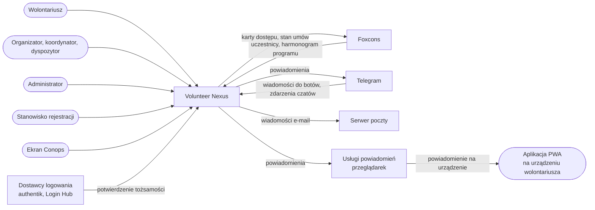
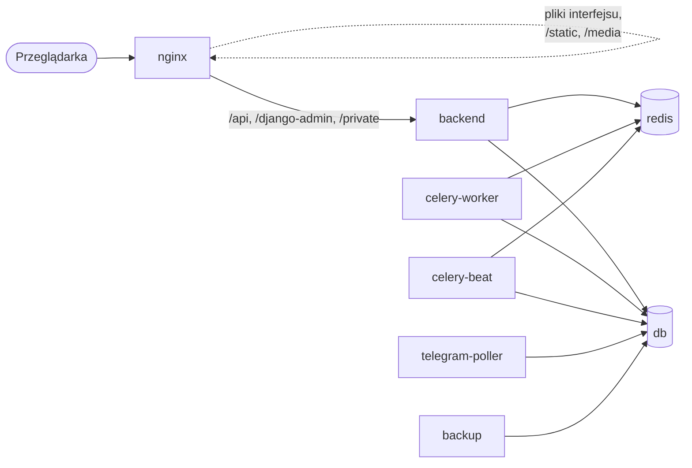

# Przegląd architektury

Volunteer Nexus jest aplikacją internetową złożoną z interfejsu w przeglądarce, serwera API, bazy danych i procesów pracujących w tle. Strona opisuje system od ogółu do szczegółu: otoczenie, uruchamiane usługi, moduły serwera i integracje. Relacje między danymi opisuje strona [Model Danych](model-danych.mdx).

## Kontekst

Otoczenie systemu przedstawia rysunek 1. Z systemu korzystają ludzie w trzech rolach i urządzenia na wydarzeniu, a system wymienia dane z pięcioma grupami usług zewnętrznych.

*Rys. 1. Kontekst systemu*

Strzałka wskazuje kierunek, w którym płyną dane, a jej opis mówi, jakie to dane. Z Foxcons i Telegramem system wymienia dane w obie strony, dlatego łączą je po dwie strzałki.

Użytkownicy i urządzenia:

- wolontariusz – aplikuje, prowadzi profil, podpisuje umowy, wybiera benefity, sprawdza zmiany,
- organizator, koordynator, dyspozytor – zarządzają działami, zmianami i zgłoszeniami,
- administrator – ustawia wydarzenie i system,
- stanowisko rejestracji – lokalna aplikacja z katalogu `counter/`, na której obsługa generuje, drukuje i przyjmuje podpisane umowy,
- ekran Conops – urządzenie pokazujące bieżące zmiany, logujące się własnym kluczem.

## Usługi

System uruchamia się jako zestaw kontenerów Docker Compose. Usługi w środowisku produkcyjnym (`docker-compose.prod.yml`) przedstawia rysunek 2.

*Rys. 2. Usługi w środowisku produkcyjnym*

Rolę każdej usługi przedstawia tabela 1.

| Usługa | Rola | Technologia |
| --- | --- | --- |
| `nginx` | serwuje zbudowany interfejs oraz pliki `/static` i `/media`; przekazuje do serwera ścieżki `/api/`, `/django-admin/` i `/private/` | nginx |
| `backend` | serwer API i panel Django Admin | Django, Django REST Framework, Gunicorn |
| `db` | baza danych | PostgreSQL 16 |
| `redis` | kolejka zadań i pamięć podręczna, w osobnych bazach logicznych | Redis 7 |
| `celery-worker` | wykonuje zadania w tle | Celery |
| `celery-beat` | uruchamia zadania cykliczne według harmonogramu zapisanego w bazie | Celery Beat, `django_celery_beat` |
| `telegram-poller` | odbiera wiadomości z Telegrama przez odpytywanie; usługa opcjonalna, w profilu `telegram-polling` | polecenie `poll_telegram_updates` |
| `backup` | wykonuje kopie zapasowe w pętli | skrypty z `docker/backup/` |

*Tabela 1. Usługi systemu*

Środowisko deweloperskie (`docker-compose.yml`) różni się w trzech miejscach:

- zamiast `nginx` działa usługa `frontend` – serwer deweloperski Vite na porcie 5173,
- dochodzi `mailhog`, który przechwytuje wysyłaną pocztę,
- nie ma usługi `backup`.

Przy starcie w środowisku produkcyjnym serwer wykonuje migracje bazy, zbiera pliki statyczne, ustawia adres zwrotny Telegrama (gdy podano `PUBLIC_BASE_URL`) i uruchamia Gunicorn (`backend/entrypoint.prod.sh`).

Usługa `nginx` nasłuchuje na porcie 80 i nie obsługuje HTTPS. System jest wystawiony do internetu przez tunel Cloudflare (Cloudflare Tunnel), który szyfruje połączenie z przeglądarką. Tunel nie jest częścią plików Docker Compose w repozytorium.

## Interfejs

Interfejs jest jedną aplikacją w przeglądarce (`frontend/`), wspólną dla wolontariuszy, organizatorów i administratorów. Kod powstaje w Vue 3 i TypeScripcie, a buduje go Vite. Stan aplikacji przechowuje Pinia, nawigację obsługuje Vue Router, a tłumaczenia (polski i angielski) – vue-i18n.

Interfejs jest aplikacją PWA (Progressive Web App): można go zainstalować na urządzeniu, pokazuje zapisane dane, gdy serwer nie odpowiada, i odbiera powiadomienia. Opisuje to strona [Aplikacja PWA i powiadomienia](pwa.md).

Interfejs komunikuje się z serwerem wyłącznie przez API pod ścieżką `/api/`.

## Serwer

Serwer jest projektem Django (`backend/`) podzielonym na 12 aplikacji. Przedstawia je tabela 2.

| Aplikacja | Odpowiedzialność |
| --- | --- |
| `users` | użytkownicy, logowanie, profil, klucze API, pola niestandardowe, niedyspozycyjność, przyjazd i wyjazd |
| `events` | wydarzenia, uczestnictwo, działy, zespoły, członkostwa, aplikacje wolontariackie, grupy dostępu, Centrum informacji |
| `agreements` | umowy, grupy umów, podpisujący, wersje plików |
| `documents` | szablony dokumentów i generowanie dokumentów |
| `benefits` | benefity, poziomy benefitów, wybór benefitów, godziny zadeklarowane i przepracowane |
| `shifts` | zmiany, stanowiska, przydziały, reguły, siatka godzin, ekrany Conops |
| `dispatch_requests` | boty zgłoszeń i zgłoszenia dyspozytorskie |
| `notifications` | powiadomienia w przeglądarce i przypomnienia o zmianach |
| `notes` | notatki |
| `telegram_events` | monitorowanie czatów Telegrama powiązanych z wydarzeniem |
| `foxcons_schedule` | sale i punkty programu pobrane z Foxcons |
| `core` | ustawienia systemu, dziennik audytu, masowa wysyłka poczty, dziennik wysłanych wiadomości |

*Tabela 2. Aplikacje serwera*

Obok aplikacji leży katalog `backend/services/`. Nie jest aplikacją Django; zawiera logikę wspólną dla kilku aplikacji i obsługę usług zewnętrznych: Foxcons, Telegram, pocztę, powiadomienia, generowanie dokumentów, RODO.

Żądania do API są uwierzytelniane na dwa sposoby: kluczem API albo tokenem JWT (`REST_FRAMEWORK` w `backend/config/settings.py`). Wolontariusz loguje się odnośnikiem wysłanym pocztą albo przez dostawcę zewnętrznego i dostaje token JWT. Kluczy API używają urządzenia i integracje.

Zmiany w najważniejszych danych zapisuje historia zmian (`django-simple-history`) oraz dziennik audytu w aplikacji `core`.

## Dane i pliki

- **Baza danych.** Wszystkie dane systemu leżą w jednej bazie PostgreSQL.
- **Pliki publiczne.** Pliki `media` (np. awatary) serwuje bezpośrednio `nginx`.
- **Pliki prywatne.** Skany umów i wygenerowane dokumenty leżą w osobnym katalogu `private`. Dostęp do nich prowadzi przez serwer, który sprawdza uprawnienia (`agreements.auth.private_file_auth_function`).
- **Pamięć podręczna i kolejka.** Redis przechowuje kolejkę zadań i pamięć podręczną w osobnych bazach logicznych, żeby czyszczenie pamięci nie usuwało zadań.

W środowisku produkcyjnym katalogi `static`, `media` i `private` są podpięte z dysku serwera (`/etc/volunteer_hub/`).

## Zadania w tle

Czynności, które trwają długo albo mają się powtarzać, serwer zleca Celery. Zadania przedstawia tabela 3.

| Obszar | Zadania |
| --- | --- |
| dokumenty | generowanie dokumentu z szablonu |
| poczta | masowa wysyłka wiadomości |
| zmiany | rozsyłanie przypomnień o zmianach |
| Foxcons | pobieranie harmonogramu, dopasowanie identyfikatorów użytkowników, synchronizacja stanu umów, ustawianie typu konta |
| Telegram | dopasowanie członków czatów do użytkowników, ponowne sprawdzenie członkostwa |
| zgłoszenia | pobieranie plików przesłanych do bota |
| porządki | usuwanie przeterminowanych wpisów dzienników |

*Tabela 3. Zadania w tle*

Harmonogram zadań cyklicznych jest zapisany w bazie i edytowany w panelu Django Admin.

## Integracje zewnętrzne

Integracje przedstawia tabela 4. Szczegóły opiszą strony w folderze „Integracje zewnętrzne”.

| Usługa | Co system z niej bierze | Co system do niej wysyła |
| --- | --- | --- |
| Foxcons | uczestników wydarzenia i ich identyfikatory, harmonogram programu (sale i punkty programu) | karty dostępu, stan umów wolontariusza, typ konta |
| Telegram | wiadomości do botów (zgłoszenia dyspozytorskie), zdarzenia wejścia i wyjścia z czatów, dane logowania przez Telegram | powiadomienia i przypomnienia |
| serwer poczty (SMTP) | – | odnośniki logowania, powiadomienia, wysyłki masowe |
| dostawcy logowania (authentik, Login Hub) | potwierdzenie tożsamości użytkownika | – |
| usługi powiadomień przeglądarek (Web Push) | – | powiadomienia, które usługa dostarcza do aplikacji PWA na urządzeniu wolontariusza |

*Tabela 4. Integracje zewnętrzne*

System korzysta z dwóch dostawców logowania, obu przez protokół OIDC: authentik oraz Login Hub, który pozwala zalogować się kontem Foxcons. Kod zawiera też obsługę logowania przez Google i GitHub, ale nie jest ona używana.

Wiadomości z Telegrama system odbiera na jeden z dwóch sposobów: przez adres zwrotny ustawiany przy starcie serwera albo przez usługę `telegram-poller`.

Foxcons to osobny system organizacji, który obsługuje rejestrację uczestników wydarzeń, przydzielanie pokojów i płatności. Volunteer Nexus nie zastępuje go, tylko wymienia z nim dane o wolontariuszach.

## Generowanie dokumentów

Dokumenty powstają z szablonów na serwerze. Obraz serwera zawiera do tego dwa narzędzia: Tectonic (skład LaTeX do PDF) i Pandoc (konwersja formatów). Generowanie przebiega jako zadanie w tle, a wynik trafia do plików prywatnych.

## Kopie zapasowe

Usługa `backup` wykonuje kopię co 24 godziny (`docker/backup/backup.sh`). Jedna kopia to archiwum `.tar.gz`, które zawiera:

- pełny zrzut bazy danych (`pg_dump`),
- pliki publiczne (`media`),
- pliki prywatne (`private`), czyli skany umów i wygenerowane dokumenty,
- plik z datą utworzenia i nazwą bazy.

Kopia nie obejmuje plików statycznych, które odtwarza się z kodu, ani danych Redis.

Kopie trafiają do katalogu na dysku tego samego serwera (`BACKUP_HOST_DIR`, domyślnie `./backups`), w trzech kategoriach. Przedstawia je tabela 5.

| Kategoria | Kiedy powstaje | Ile kopii zostaje |
| --- | --- | --- |
| dzienna | przy każdym wykonaniu | 7 |
| tygodniowa | w niedzielę | 4 |
| miesięczna | pierwszego dnia miesiąca | 12 |

*Tabela 5. Kategorie kopii zapasowych (wartości domyślne)*

Odstęp między kopiami i liczby przechowywanych kopii ustawia się zmiennymi środowiskowymi. Kopię na żądanie i odtwarzanie opisuje `docs/production-backup-runbook.md` w repozytorium głównym.

Repozytorium nie zawiera mechanizmu, który wysyła kopie poza serwer.
