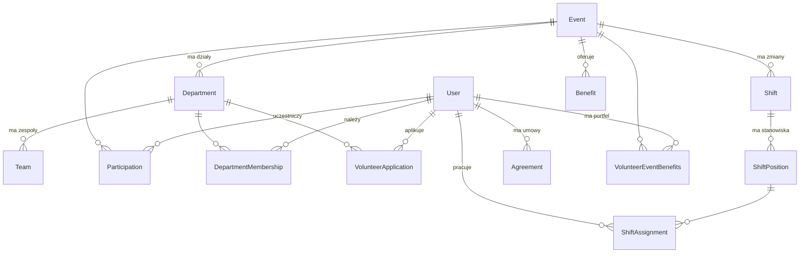

import SvgViewer from '@site/src/components/SvgViewer';

# Post-Futrołajki Model Danych

Strona opisuje wszystkie relacje między modelami systemu w stanie po wydarzeniu Futrołajki 2026 (commit `551cee1`, 2026-11-20). Lista powstała z rejestru modeli Django działającego backendu, a nie z ręcznego przeglądu plików, więc obejmuje każdą relację zdefiniowaną w kodzie.

System ma 64 modele własne w 12 aplikacjach Django, połączone 165 relacjami (nie licząc modeli historii zmian). Dwa modele są węzłami całego modelu danych: `User` (wolontariusz) i `Event` (wydarzenie) – prawie każdy inny model wskazuje na co najmniej jeden z nich.

## Jak czytać tabele

Każdy wiersz to jedno pole relacji zdefiniowane w modelu z pierwszej kolumny.

Kolumna „Typ”:

- N:1 – wiele rekordów tego modelu wskazuje na jeden rekord celu (`ForeignKey`),
- 1:1 – jeden rekord na jeden rekord celu (`OneToOneField`),
- N:N – wiele do wielu (`ManyToManyField`).

Kolumna „Usunięcie celu” mówi, co dzieje się z rekordem, gdy usuwany jest rekord, na który wskazuje:

- `CASCADE` – rekord jest usuwany razem z celem,
- `SET_NULL` – rekord zostaje, pole staje się puste,
- `PROTECT` – usunięcie celu jest blokowane,
- `RESTRICT` – usunięcie celu jest blokowane, chyba że cel znika w ramach kaskady z modelu nadrzędnego,
- „–” – nie dotyczy (relacja N:N; usuwane jest tylko powiązanie).

## Rdzeń modelu

Najważniejsze relacje przedstawia rysunek 1. Pełne listy są w kolejnych sekcjach.

*Rys. 1. Rdzeń modelu danych*

## Pełny diagram

Wszystkie modele i relacje przedstawia rysunek 2. Diagram jest duży: powiększaj przyciskami albo kółkiem myszy z wciśniętym Ctrl, przesuwaj przeciąganiem.

<SvgViewer src="/diagramy/model-danych-post-futrolajki.svg" alt="Diagram wszystkich modeli i relacji" />

*Rys. 2. Wszystkie modele i relacje*

Linia ciągła oznacza `CASCADE`, przerywana `SET_NULL`, czerwona `PROTECT` lub `RESTRICT`, niebieska relację N:N. Plik źródłowy do edycji w draw.io: [model-danych-post-futrolajki.drawio](pathname:///diagramy/model-danych-post-futrolajki.drawio).

## Użytkownicy (`backend/users/`)

`User` nie ma własnych relacji do modeli systemu poza standardowymi grupami i uprawnieniami Django. Jest celem relacji z pozostałych modeli.

| Model | Pole | Typ | Cel | Usunięcie celu |
| --- | --- | --- | --- | --- |
| `User` | `groups` | N:N | `auth.Group` | – |
| `User` | `user_permissions` | N:N | `auth.Permission` | – |
| `UserApiKey` | `user` | N:1 | `User` | `CASCADE` |
| `UserApiKey` | `created_by` | N:1 | `User` | `SET_NULL` |
| `UserUnavailability` | `event` | N:1 | `Event` | `CASCADE` |
| `UserUnavailability` | `user` | N:1 | `User` | `CASCADE` |
| `UserUnavailability` | `denied_by` | N:1 | `User` | `SET_NULL` |
| `UserUnavailability` | `created_by` | N:1 | `User` | `SET_NULL` |
| `VolunteerArrivalDeparture` | `event` | N:1 | `Event` | `CASCADE` |
| `VolunteerArrivalDeparture` | `user` | N:1 | `User` | `CASCADE` |
| `VolunteerArrivalDeparture` | `created_by` | N:1 | `User` | `SET_NULL` |
| `CustomFieldDefinition` | `event` | N:1 | `Event` | `CASCADE` |
| `CustomFieldDefinition` | `departments` | N:N | `Department` | – |
| `CustomFieldDefinition` | `teams` | N:N | `Team` | – |

Ograniczenia unikalności:

- `UserApiKey`: jedna nazwa klucza na użytkownika (`user`, `name`),
- `VolunteerArrivalDeparture`: jeden wpis przyjazdu i wyjazdu na wolontariusza w wydarzeniu (`event`, `user`),
- `CustomFieldDefinition`: jeden klucz pola w wydarzeniu (`event`, `key`).

`CustomFieldDefinition` opisuje strukturę pola `User.custom_data`. Wartości pól niestandardowych leżą w tym polu JSON, a nie w osobnej tabeli, więc między definicją a wartością nie ma relacji w bazie.

## Wydarzenia, działy i zespoły (`backend/events/`)

| Model | Pole | Typ | Cel | Usunięcie celu |
| --- | --- | --- | --- | --- |
| `Event` | `volunteer_agreement_group` | N:1 | `AgreementGroup` | `SET_NULL` |
| `Event` | `event_admins` | N:N | `User` | – |
| `Participation` | `user` | N:1 | `User` | `CASCADE` |
| `Participation` | `event` | N:1 | `Event` | `CASCADE` |
| `Department` | `event` | N:1 | `Event` | `CASCADE` |
| `Department` | `organizers` | N:N | `User` | – |
| `Department` | `dispatchers` | N:N | `User` | – |
| `Department` | `shift_operators` | N:N | `User` | – |
| `Department` | `schedule_halls` | N:N | `FoxconsHall` | – |
| `Department` | `schedule_panels` | N:N | `FoxconsScheduleEntry` | – |
| `Team` | `department` | N:1 | `Department` | `CASCADE` |
| `DepartmentMembership` | `department` | N:1 | `Department` | `CASCADE` |
| `DepartmentMembership` | `user` | N:1 | `User` | `CASCADE` |
| `DepartmentMembership` | `teams` | N:N | `Team` | – |
| `DepartmentMembershipTeamAssignment` | `membership` | N:1 | `DepartmentMembership` | `CASCADE` |
| `DepartmentMembershipTeamAssignment` | `team` | N:1 | `Team` | `CASCADE` |
| `AccessGroup` | `event` | N:1 | `Event` | `CASCADE` |
| `AccessGroup` | `departments` | N:N | `Department` | – |
| `AccessGroup` | `teams` | N:N | `Team` | – |
| `AccessGroup` | `volunteers` | N:N | `User` | – |
| `VolunteerApplication` | `user` | N:1 | `User` | `CASCADE` |
| `VolunteerApplication` | `department` | N:1 | `Department` | `CASCADE` |
| `VolunteerApplication` | `team` | N:1 | `Team` | `SET_NULL` |
| `VolunteerApplication` | `event` | N:1 | `Event` | `CASCADE` |
| `VolunteerApplication` | `reviewed_by` | N:1 | `User` | `SET_NULL` |
| `InformationHubPage` | `event` | N:1 | `Event` | `CASCADE` |
| `InformationHubPage` | `department` | N:1 | `Department` | `RESTRICT` |
| `InformationHubComponent` | `page` | N:1 | `InformationHubPage` | `CASCADE` |

Ograniczenia unikalności:

- `Participation`: jedna rola wolontariusza w wydarzeniu (`user`, `event`, `role`) – ten sam wolontariusz może mieć w jednym wydarzeniu kilka uczestnictw w różnych rolach,
- `Department`: jeden klucz działu w wydarzeniu (`event`, `key`),
- `Team`: jeden klucz zespołu w dziale (`department`, `key`),
- `DepartmentMembership`: jedno członkostwo wolontariusza w dziale (`department`, `user`),
- `DepartmentMembershipTeamAssignment`: jedno przypisanie członkostwa do zespołu (`membership`, `team`),
- `AccessGroup`: jeden identyfikator grupy w wydarzeniu (`event`, `slug`),
- `VolunteerApplication`: dwa ograniczenia warunkowe na (`user`, `department`, `event`, `status`) oraz (`user`, `department`, `team`, `event`, `status`); warunki są w `backend/events/models.py`,
- `InformationHubPage`: jeden adres strony w wydarzeniu (`event`, `slug`) oraz warunkowo jedna strona na wydarzenie (ograniczenie na samym `event`),
- `InformationHubComponent`: jedna pozycja w kolejności na stronie (`page`, `order`).

Uwagi:

- Zespół należy do działu, a dział do wydarzenia. `Team` nie ma własnego pola `event` – wydarzenie zespołu wynika z działu.
- Przynależność wolontariusza do zespołu jest zapisana na dwa sposoby: polem N:N `DepartmentMembership.teams` oraz osobnym modelem `DepartmentMembershipTeamAssignment`, który przechowuje dodatkowo stanowisko i notatkę. TODO(pytanie): który zapis jest źródłem prawdy.
- `AccessGroup` według opisu w kodzie odpowiada karcie dostępu Foxcons: działy, zespoły i wolontariusze, którzy mogą wejść do tych samych stref.

## Umowy (`backend/agreements/`)

| Model | Pole | Typ | Cel | Usunięcie celu |
| --- | --- | --- | --- | --- |
| `Agreement` | `user` | N:1 | `User` | `CASCADE` |
| `Agreement` | `event` | N:1 | `Event` | `SET_NULL` |
| `Agreement` | `requested_by` | N:1 | `User` | `SET_NULL` |
| `Agreement` | `groups` | N:N | `AgreementGroup` | – |
| `AgreementGroup` | `event` | N:1 | `Event` | `SET_NULL` |
| `AgreementGroupExemption` | `group` | N:1 | `AgreementGroup` | `CASCADE` |
| `AgreementGroupExemption` | `user` | N:1 | `User` | `CASCADE` |
| `AgreementGroupExemption` | `created_by` | N:1 | `User` | `SET_NULL` |
| `AgreementSigner` | `agreement` | N:1 | `Agreement` | `CASCADE` |
| `AgreementSigner` | `user` | N:1 | `User` | `SET_NULL` |
| `AgreementSigner` | `returned_by` | N:1 | `User` | `SET_NULL` |
| `AgreementVersion` | `agreement` | N:1 | `Agreement` | `CASCADE` |
| `AgreementVersion` | `signer` | N:1 | `AgreementSigner` | `SET_NULL` |
| `AgreementVersion` | `uploaded_by` | N:1 | `User` | `SET_NULL` |

Ograniczenia unikalności:

- `Agreement`: warunkowo jedna umowa danego typu na użytkownika (`user`, `type`),
- `AgreementGroupExemption`: jedno zwolnienie użytkownika z grupy (`group`, `user`),
- `AgreementSigner`: warunkowo jeden wpis podpisującego na użytkownika w umowie (`agreement`, `user`).

Uwagi:

- Grupa umów to według opisu w kodzie zestaw umów zamiennych: dowolna podpisana lub oczekująca umowa z grupy pokrywa wolontariusza.
- `AgreementGroupExemption` oznacza, że wolontariusz nie musi podpisywać umów z grupy do dnia `expires_on` włącznie.
- Umowa przeżywa usunięcie wydarzenia (`SET_NULL`), ale znika razem z użytkownikiem (`CASCADE`).

## Dokumenty (`backend/documents/`)

| Model | Pole | Typ | Cel | Usunięcie celu |
| --- | --- | --- | --- | --- |
| `DocumentTemplate` | `event` | N:1 | `Event` | `SET_NULL` |
| `DocumentTemplate` | `agreement_groups` | N:N | `AgreementGroup` | – |
| `GeneratedDocument` | `template` | N:1 | `DocumentTemplate` | `PROTECT` |
| `GeneratedDocument` | `user` | N:1 | `User` | `CASCADE` |
| `GeneratedDocument` | `requested_by` | N:1 | `User` | `SET_NULL` |
| `GeneratedDocument` | `agreement` | N:1 | `Agreement` | `SET_NULL` |

Szablonu dokumentu nie da się usunąć, dopóki istnieją wygenerowane z niego dokumenty (`PROTECT`).

## Benefity i godziny (`backend/benefits/`)

| Model | Pole | Typ | Cel | Usunięcie celu |
| --- | --- | --- | --- | --- |
| `Benefit` | `event` | N:1 | `Event` | `CASCADE` |
| `Benefit` | `levels` | N:N | `EventBenefitLevel` | – |
| `EventBenefitLevel` | `event` | N:1 | `Event` | `CASCADE` |
| `VolunteerEventBenefits` | `user` | N:1 | `User` | `CASCADE` |
| `VolunteerEventBenefits` | `event` | N:1 | `Event` | `CASCADE` |
| `VolunteerEventBenefits` | `assigned_level` | N:1 | `EventBenefitLevel` | `SET_NULL` |
| `VolunteerEventBenefits` | `hours_declaration_locked_by` | N:1 | `User` | `SET_NULL` |
| `BenefitSelection` | `wallet` | N:1 | `VolunteerEventBenefits` | `CASCADE` |
| `BenefitSelection` | `benefit` | N:1 | `Benefit` | `CASCADE` |
| `DeclaredHoursAssignment` | `wallet` | N:1 | `VolunteerEventBenefits` | `CASCADE` |
| `DeclaredHoursAssignment` | `department` | N:1 | `Department` | `CASCADE` |
| `DeclaredHoursAssignment` | `team` | N:1 | `Team` | `SET_NULL` |
| `DeclaredHoursAssignment` | `assigned_by` | N:1 | `User` | `SET_NULL` |
| `WorkedHoursEntry` | `user` | N:1 | `User` | `CASCADE` |
| `WorkedHoursEntry` | `event` | N:1 | `Event` | `CASCADE` |
| `WorkedHoursEntry` | `department` | N:1 | `Department` | `CASCADE` |
| `WorkedHoursEntry` | `team` | N:1 | `Team` | `SET_NULL` |
| `WorkedHoursEntry` | `created_by` | N:1 | `User` | `SET_NULL` |

Ograniczenia unikalności:

- `Benefit`: jeden tytuł benefitu w wydarzeniu (`event`, `title`),
- `EventBenefitLevel`: jedna nazwa poziomu benefitów w wydarzeniu (`event`, `name`),
- `VolunteerEventBenefits`: jeden rekord na wolontariusza w wydarzeniu (`user`, `event`),
- `BenefitSelection`: benefit można wybrać raz (`wallet`, `benefit`),
- `DeclaredHoursAssignment`: dwa ograniczenia warunkowe na (`wallet`, `department`, `team`, `phase`) oraz (`wallet`, `department`, `phase`).

Uwagi:

- `VolunteerEventBenefits` łączy wolontariusza z wydarzeniem po stronie benefitów; w kodzie pole wskazujące na ten model nazywa się `wallet`. Wybrane benefity i zadeklarowane godziny są podpięte do tego rekordu, a nie bezpośrednio do użytkownika.
- Przepracowane godziny (`WorkedHoursEntry`) są podpięte bezpośrednio do użytkownika, wydarzenia i działu, z pominięciem `VolunteerEventBenefits`.

## Zmiany (`backend/shifts/`)

### Zmiany, stanowiska, przypisania

| Model | Pole | Typ | Cel | Usunięcie celu |
| --- | --- | --- | --- | --- |
| `ShiftLocation` | `event` | N:1 | `Event` | `CASCADE` |
| `ShiftLocation` | `departments` | N:N | `Department` | – |
| `Shift` | `event` | N:1 | `Event` | `CASCADE` |
| `Shift` | `location` | N:1 | `ShiftLocation` | `SET_NULL` |
| `Shift` | `grid_category` | N:1 | `ShiftGridCategory` | `SET_NULL` |
| `ShiftPosition` | `shift` | N:1 | `Shift` | `CASCADE` |
| `ShiftPosition` | `department` | N:1 | `Department` | `SET_NULL` |
| `ShiftPosition` | `team` | N:1 | `Team` | `SET_NULL` |
| `ShiftPosition` | `grid_category` | N:1 | `ShiftGridCategory` | `SET_NULL` |
| `ShiftPosition` | `rule_templates` | N:N | `ShiftRuleTemplate` | – |
| `ShiftAssignment` | `position` | N:1 | `ShiftPosition` | `CASCADE` |
| `ShiftAssignment` | `user` | N:1 | `User` | `CASCADE` |
| `ShiftAssignment` | `assigned_by` | N:1 | `User` | `SET_NULL` |
| `ShiftAssignment` | `replaces` | N:1 | `ShiftAssignment` | `SET_NULL` |
| `ShiftAssignment` | `attendance_marked_by` | N:1 | `User` | `SET_NULL` |
| `ShiftTask` | `shift` | N:1 | `Shift` | `CASCADE` |
| `ShiftTask` | `dispatch_request` | N:1 | `DispatchRequest` | `CASCADE` |
| `ShiftTaskAssignment` | `task` | N:1 | `ShiftTask` | `CASCADE` |
| `ShiftTaskAssignment` | `assignment` | N:1 | `ShiftAssignment` | `CASCADE` |
| `ShiftTaskAssignment` | `assigned_by` | N:1 | `User` | `SET_NULL` |

### Szablony i reguły

| Model | Pole | Typ | Cel | Usunięcie celu |
| --- | --- | --- | --- | --- |
| `ShiftTemplate` | `event` | N:1 | `Event` | `CASCADE` |
| `ShiftTemplate` | `departments` | N:N | `Department` | – |
| `ShiftTemplatePosition` | `template` | N:1 | `ShiftTemplate` | `CASCADE` |
| `ShiftTemplatePosition` | `department` | N:1 | `Department` | `SET_NULL` |
| `ShiftTemplatePosition` | `team` | N:1 | `Team` | `SET_NULL` |
| `ShiftTemplatePosition` | `rule_templates` | N:N | `ShiftRuleTemplate` | – |
| `ShiftTemplateTask` | `template` | N:1 | `ShiftTemplate` | `CASCADE` |
| `ShiftRuleTemplate` | `event` | N:1 | `Event` | `CASCADE` |
| `ShiftRuleGroup` | `template` | N:1 | `ShiftRuleTemplate` | `CASCADE` |
| `ShiftRuleGroup` | `parent` | N:1 | `ShiftRuleGroup` | `CASCADE` |
| `ShiftRule` | `group` | N:1 | `ShiftRuleGroup` | `CASCADE` |

### Siatka i ekrany

| Model | Pole | Typ | Cel | Usunięcie celu |
| --- | --- | --- | --- | --- |
| `ShiftGridCategory` | `event` | N:1 | `Event` | `CASCADE` |
| `ShiftGridCategory` | `department` | N:1 | `Department` | `CASCADE` |
| `ShiftGridCategory` | `location` | N:1 | `ShiftLocation` | `SET_NULL` |
| `ShiftGridCategory` | `team` | N:1 | `Team` | `SET_NULL` |
| `ShiftGridCategory` | `rule_template` | N:1 | `ShiftRuleTemplate` | `SET_NULL` |
| `ShiftGridPersonSetting` | `department` | N:1 | `Department` | `CASCADE` |
| `ShiftGridPersonSetting` | `user` | N:1 | `User` | `CASCADE` |
| `ShiftGridRequirement` | `department` | N:1 | `Department` | `CASCADE` |
| `ShiftGridRequirementCategory` | `requirement` | N:1 | `ShiftGridRequirement` | `CASCADE` |
| `ShiftGridRequirementCategory` | `category` | N:1 | `ShiftGridCategory` | `CASCADE` |
| `ScheduleAnnotation` | `event` | N:1 | `Event` | `CASCADE` |
| `ConopsScreen` | `event` | N:1 | `Event` | `CASCADE` |
| `ConopsScreen` | `api_key` | 1:1 | `UserApiKey` | `CASCADE` |
| `ConopsScreen` | `created_by` | N:1 | `User` | `SET_NULL` |
| `ConopsScreen` | `departments` | N:N | `Department` | – |
| `ConopsScreen` | `shift_locations` | N:N | `ShiftLocation` | – |

Ograniczenia unikalności:

- `ShiftLocation`: jeden klucz lokalizacji w wydarzeniu (`event`, `key`),
- `ShiftAssignment`: warunkowo jedno przypisanie wolontariusza do stanowiska (`position`, `user`),
- `ShiftTaskAssignment`: jedno powiązanie zadania z przypisaniem (`task`, `assignment`),
- `ShiftGridCategory`: jeden kod kategorii w dziale (`department`, `code`),
- `ShiftGridPersonSetting`: jedno ustawienie wolontariusza w dziale (`department`, `user`),
- `ShiftGridRequirementCategory`: jedna kategoria w wymaganiu (`requirement`, `category`).

Uwagi:

- Wolontariusz nie jest przypisany do zmiany wprost. Łańcuch to: zmiana (`Shift`) → stanowisko (`ShiftPosition`) → przypisanie (`ShiftAssignment`) → użytkownik.
- Zadanie należy do zmiany, a wykonawcę wskazuje przez przypisanie do stanowiska (`ShiftTaskAssignment.assignment`), nie bezpośrednio przez użytkownika.
- Dwie relacje wskazują na ten sam model: `ShiftAssignment.replaces` (przypisanie zastępujące inne) i `ShiftRuleGroup.parent` (grupy reguł zagnieżdżone w drzewo).
- Zadanie może pochodzić ze zgłoszenia dyspozytorskiego (`ShiftTask.dispatch_request`); usunięcie zgłoszenia usuwa zadanie.
- Ekran Conops ma własny klucz API w relacji 1:1; usunięcie klucza usuwa ekran.
- Szablon zmiany powiela strukturę zmiany: `ShiftTemplatePosition` i `ShiftTemplateTask` odpowiadają `ShiftPosition` i `ShiftTask`.

## Dyspozytor (`backend/dispatch_requests/`)

| Model | Pole | Typ | Cel | Usunięcie celu |
| --- | --- | --- | --- | --- |
| `DispatchBot` | `event` | N:1 | `Event` | `CASCADE` |
| `DispatchBot` | `created_by` | N:1 | `User` | `SET_NULL` |
| `DispatchBot` | `helper_shifts` | N:N | `Shift` | – |
| `DispatchBot` | `dispatchers` | N:N | `User` | – |
| `DispatchBot` | `live_dispatchers` | N:N | `User` | – |
| `DispatchBotChat` | `bot` | N:1 | `DispatchBot` | `CASCADE` |
| `DispatchBotChat` | `user` | N:1 | `User` | `SET_NULL` |
| `DispatchRequest` | `bot` | N:1 | `DispatchBot` | `CASCADE` |
| `DispatchRequest` | `chat` | N:1 | `DispatchBotChat` | `CASCADE` |
| `DispatchRequest` | `requester` | N:1 | `User` | `SET_NULL` |
| `DispatchRequest` | `hall` | N:1 | `FoxconsHall` | `SET_NULL` |
| `DispatchRequest` | `claimed_by` | N:1 | `User` | `SET_NULL` |
| `DispatchRequest` | `closed_by` | N:1 | `User` | `SET_NULL` |
| `DispatchRequest` | `assignees` | N:N | `User` | – |
| `DispatchRequest` | `done_by` | N:N | `User` | – |
| `DispatchRequestEntry` | `request` | N:1 | `DispatchRequest` | `CASCADE` |
| `DispatchRequestEntry` | `author` | N:1 | `User` | `SET_NULL` |

Ograniczenie unikalności: `DispatchBotChat` – jedna rozmowa na parę (`bot`, `chat_id`).

Uwagi:

- `DispatchBot` to według opisu w kodzie bot Telegrama przyjmujący zgłoszenia dla jednego wydarzenia; konfiguruje też ekran dyspozytora, który te zgłoszenia obsługuje.
- Zgłoszenie nie ma własnego pola `event` – wydarzenie wynika z bota.
- `DispatchRequestEntry` to oś czasu zgłoszenia: rozmowa ze zgłaszającym, notatki dyspozytora i zdarzenia systemowe.

## Powiadomienia (`backend/notifications/`)

| Model | Pole | Typ | Cel | Usunięcie celu |
| --- | --- | --- | --- | --- |
| `PushSubscription` | `user` | N:1 | `User` | `CASCADE` |
| `ShiftReminderNotification` | `assignment` | N:1 | `ShiftAssignment` | `CASCADE` |

Ograniczenia unikalności:

- `PushSubscription`: jeden adres powiadomień na użytkownika (`user`, `endpoint`),
- `ShiftReminderNotification`: jedno przypomnienie na przypisanie i okno czasu (`assignment`, `window_minutes`).

## Notatki (`backend/notes/`)

| Model | Pole | Typ | Cel | Usunięcie celu |
| --- | --- | --- | --- | --- |
| `Note` | `department` | N:1 | `Department` | `CASCADE` |
| `Note` | `author` | N:1 | `User` | `CASCADE` |

Pole `department` może być puste.

## Telegram (`backend/telegram_events/`)

| Model | Pole | Typ | Cel | Usunięcie celu |
| --- | --- | --- | --- | --- |
| `EventTelegramChat` | `event` | N:1 | `Event` | `CASCADE` |
| `TelegramChatMembership` | `chat` | N:1 | `EventTelegramChat` | `CASCADE` |
| `TelegramChatMembership` | `matched_user` | N:1 | `User` | `SET_NULL` |
| `TelegramChatMembership` | `kicked_by` | N:1 | `User` | `SET_NULL` |
| `TelegramMembershipEvent` | `chat` | N:1 | `EventTelegramChat` | `CASCADE` |
| `TelegramMembershipEvent` | `matched_user` | N:1 | `User` | `SET_NULL` |

Ograniczenia unikalności:

- `EventTelegramChat`: warunkowo jeden wpis na `chat_id`,
- `TelegramChatMembership`: jeden wpis na parę (`chat`, `telegram_user_id`).

Uwagi:

- `TelegramChatMembership` to według opisu w kodzie bieżący stan członkostwa, a `TelegramMembershipEvent` – dziennik wejść i wyjść, do którego wpisy są tylko dopisywane.
- `KnownTelegramChat` nie ma relacji do innych modeli.

## Harmonogram Foxcons (`backend/foxcons_schedule/`)

| Model | Pole | Typ | Cel | Usunięcie celu |
| --- | --- | --- | --- | --- |
| `FoxconsHall` | `event` | N:1 | `Event` | `CASCADE` |
| `FoxconsScheduleEntry` | `event` | N:1 | `Event` | `CASCADE` |
| `FoxconsScheduleEntry` | `hall` | N:1 | `FoxconsHall` | `SET_NULL` |

Ograniczenie unikalności: oba modele – jeden identyfikator Foxcons w wydarzeniu (`event`, `foxcons_id`).

## Ustawienia, dziennik i wiadomości (`backend/core/`)

| Model | Pole | Typ | Cel | Usunięcie celu |
| --- | --- | --- | --- | --- |
| `AuditLog` | `actor` | N:1 | `User` | `SET_NULL` |
| `AuditLog` | `event` | N:1 | `Event` | `SET_NULL` |
| `BulkEmailTask` | `requested_by` | N:1 | `User` | `SET_NULL` |
| `BulkEmailTask` | `event` | N:1 | `Event` | `SET_NULL` |
| `OutboundEmailLog` | `sent_by` | N:1 | `User` | `SET_NULL` |
| `OutboundMessageLog` | `triggered_by` | N:1 | `User` | `SET_NULL` |
| `OutboundMessageLog` | `recipient_user` | N:1 | `User` | `SET_NULL` |
| `OutboundMessageLog` | `event` | N:1 | `Event` | `SET_NULL` |

Uwagi:

- Wszystkie relacje w tej aplikacji mają `SET_NULL`: wpisy dziennika i historii wiadomości zostają po usunięciu użytkownika lub wydarzenia.
- `AuditLog` wskazuje zmieniany rekord polami `resource_type` i `resource_id`, a nie kluczem obcym, więc baza nie pilnuje tego powiązania.
- `AppSettings` nie ma relacji do innych modeli.

## Historia zmian

34 modele mają kopię historyczną tworzoną przez bibliotekę `django-simple-history`. Dla każdego z nich istnieje model `Historical…` o tych samych polach. Relacje w modelach historycznych nie są egzekwowane (`DO_NOTHING`), więc historia zostaje po usunięciu rekordów, na które wskazywała. Każdy wpis historii ma dodatkowo pole `history_user` wskazujące na `User` (`SET_NULL`).

Modele z historią:

- użytkownicy: `User`, `UserUnavailability`, `VolunteerArrivalDeparture`,
- wydarzenia: `Event`, `Participation`, `Department`, `Team`, `DepartmentMembership`, `VolunteerApplication`,
- umowy: `Agreement`, `AgreementGroup`, `AgreementGroupExemption`,
- dokumenty: `DocumentTemplate`,
- benefity: `Benefit`, `BenefitSelection`, `VolunteerEventBenefits`, `DeclaredHoursAssignment`, `WorkedHoursEntry`,
- zmiany: `Shift`, `ShiftPosition`, `ShiftAssignment`, `ShiftTask`, `ShiftTaskAssignment`, `ShiftLocation`, `ShiftTemplate`, `ShiftTemplatePosition`, `ShiftTemplateTask`, `ShiftRuleTemplate`, `ShiftGridCategory`, `ShiftGridRequirement`, `ScheduleAnnotation`, `ConopsScreen`,
- dyspozytor: `DispatchBot`, `DispatchRequest`.

Dla `DispatchRequest` historia obejmuje też relacje N:N `assignees` i `done_by`.
