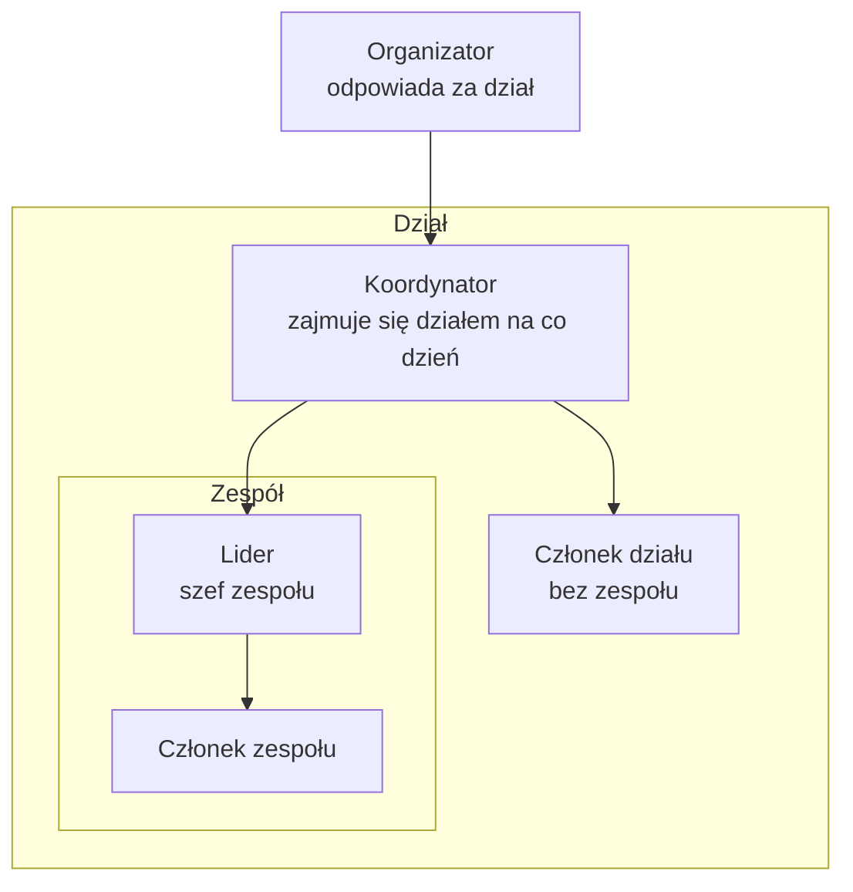
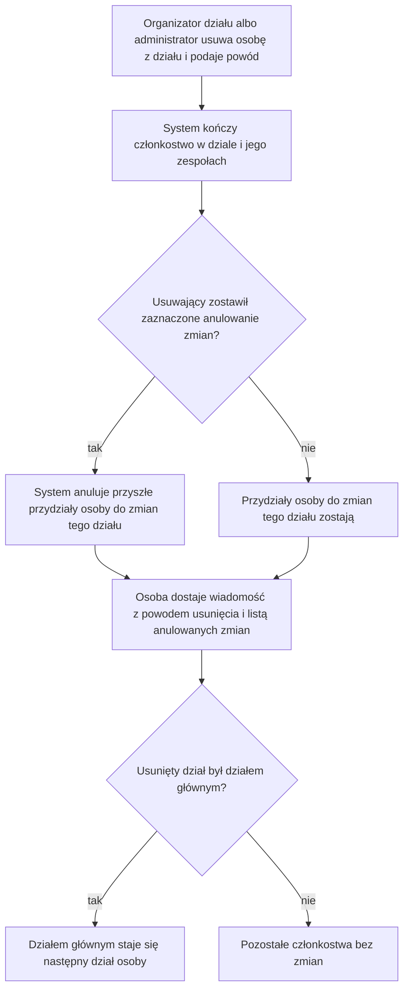

# Działy i zespoły

Działy i zespoły to podział wolontariuszy na wydarzeniu: dział zajmuje się dużym wycinkiem wydarzenia, a zespół mniejszym wycinkiem w ramach działu. Ta strona opisuje, co ustawia się w dziale i w zespole, jakie role mają w nich osoby, jak powstaje członkostwo i jak usuwa się osobę z działu.

## Założenia

- Dział należy do jednego wydarzenia. Zespół należy do jednego działu.
- Wolontariusz pracuje w dziale jako jego członek. Członkostwo łączy jedną osobę z jednym działem.
- Osoba może należeć do kilku działów, a w dziale do kilku zespołów albo do żadnego. Nie można należeć do zespołu bez członkostwa w jego dziale.
- Członkostwo powstaje na dwa sposoby: przez zaakceptowaną aplikację wolontariacką albo gdy osobę doda organizator lub administrator.
- Dział nie ma limitu miejsc.
- Osoba ma w dziale jedno oznaczenie – organizator, koordynator albo członek – a w każdym zespole może mieć osobne. Oznaczenie mówi, czym osoba się zajmuje, i samo nie daje uprawnień.
- Wydarzenie może mieć wielu organizatorów, dział wielu koordynatorów, a zespół wielu liderów.
- Działami zarządza organizator, którego rola na to pozwala. Uprawnienia do działu działają w tych działach, których osoba jest członkiem.
- Działu, który ma członków, nie można usunąć.
- Przy członkostwach osoby widać, który dział jest jej działem głównym.
- Akceptacji aplikacji nie można cofnąć. Osobę, która ma odejść z działu, usuwa się z działu.
- Usunięcie z działu nie kończy uczestnictwa w wydarzeniu, a usunięcie z wydarzenia nie wyłącza konta.
- Listę działów z członkami widzi każdy wolontariusz wydarzenia. Dane kontaktowe członka widać tylko wtedy, gdy ta osoba je udostępniła.
- System zapisuje w dzienniku audytu każde dodanie, zmianę i usunięcie członkostwa: kto i kiedy.

## Działy a wydarzenie

Każde wydarzenie ma własną listę działów i zespołów. Dział o tej samej nazwie na dwóch wydarzeniach to dwa osobne działy, z osobnymi członkami i ustawieniami.

Osoba zostaje członkiem działu tylko wtedy, gdy ma uczestnictwo w wydarzeniu. Akceptacja aplikacji tworzy uczestnictwo i członkostwo razem.

## Ustawienia działu

Ustawienia działu przedstawia tabela 1.

| Ustawienie | Opis |
| --- | --- |
| Nazwa i opis | Podawane osobno dla każdego języka; opis widać w formularzu aplikacji i na liście działów |
| Organizatorzy, koordynatorzy | Osoby odpowiedzialne za dział; widoczne w formularzu aplikacji jako osoby kontaktowe |
| Termin aplikacji | Własny termin działu, wcześniejszy niż termin wydarzenia; po nim formularz pokazuje dział jako zamknięty |
| Wyłączenie z aplikacji | Formularz nie pokazuje działu; osoby dodaje do niego tylko organizator lub administrator |
| Wybór zespołów | Czy osoba może w aplikacji wybrać zespoły tego działu |
| Tryb planowania | Tryb standardowy albo siatka godzin (zob. [Definicje i podstawowe typy zmian](../zmiany/definicje.md)) |
| Operatorzy zmian i dyspozytorzy | Osoby, które planują zmiany działu i obsługują zgłoszenia (zob. [Dyspozytor](../zmiany/dyspozytor.md)) |
| Sale i punkty programu | Sale i punkty programu z harmonogramu Foxcons, którymi dział się zajmuje |

*Tabela 1. Ustawienia działu*

Działy tworzy, zmienia i usuwa organizator, którego rola na to pozwala.

Zmiana trybu planowania nie usuwa zmian, które dział już ma.

Działu nie można usunąć, gdy ma członków albo strony w centrum informacji. Najpierw trzeba usunąć członków z działu i przenieść albo usunąć strony.

## Zespoły

Zespół ma nazwę i opis, podawane osobno dla każdego języka. Opis widać w formularzu aplikacji i przy członkach zespołu na liście działów.

Zespół jest oznaczony jako dostępny do wyboru w aplikacji albo nie. Osoba może wybrać zespół w formularzu tylko wtedy, gdy dział pozwala na wybór zespołów i zespół jest oznaczony jako dostępny. Do pozostałych zespołów osoby przypisuje organizator.

Zespoły działu tworzy, zmienia i usuwa organizator, którego rola na to pozwala w tym dziale.

## Oznaczenia w dziale

Podział na organizatora, koordynatora, lidera i członka przedstawia rysunek 1.

*Rys. 1. Podział na organizatora, koordynatora, lidera i członka*

Oznaczenia w dziale i w zespole przedstawia tabela 2.

| Oznaczenie | Gdzie | Czym się zajmuje |
| --- | --- | --- |
| Organizator | Dział | Odpowiada za dział: dodaje i usuwa członków, przypisuje ich do zespołów, zarządza zespołami; dział może mieć kilku |
| Koordynator | Dział | Zajmuje się działem na co dzień; dział może mieć kilku |
| Lider | Zespół | Jest szefem zespołu; współpracuje z koordynatorem i organizatorem; zespół może mieć kilku |
| Członek | Dział, zespół | Pracuje w dziale lub zespole |
| Operator zmian | Dział | Planuje zmiany działu |
| Dyspozytor | Dział | Obsługuje zgłoszenia działu |

*Tabela 2. Oznaczenia w dziale i w zespole*

Organizator działu jest zawsze jego członkiem: osoba wyznaczona na organizatora dostaje członkostwo, jeśli go nie miała. Operator zmian i dyspozytor nie muszą być członkami działu.

Tabela opisuje, czym osoba zajmuje się w dziale, a nie co może zrobić w systemie. Samo oznaczenie jako organizator, koordynator albo lider nie daje żadnych uprawnień. Uprawnienia daje osobno przydzielany zestaw uprawnień; system może go zasugerować przy dodawaniu organizatora (zob. [Uprawnienia i role](../administrator/uprawnienia-i-role.md)). Uprawnienia do działu działają we własnych działach osoby. Przykładowo, organizator z uprawnieniem „zarządzanie osobami w dziale” zarządza członkami tych działów, do których sam należy, a nie wszystkich działów wydarzenia. Gdy osoba przestaje być członkiem działu, jej uprawnienia w tym dziale przestają działać.

## Członkostwo

Sposoby powstania członkostwa przedstawia tabela 3.

| Sposób | Kto zaczyna | Uwagi |
| --- | --- | --- |
| Aplikacja wolontariacka | Osoba aplikuje, rozpatrujący akceptuje | Osoba trafia do działu i do zespołów wybranych w aplikacji (zob. [Rozpatrywanie aplikacji](rozpatrywanie-aplikacji.md)) |
| Dodanie ręczne | Organizator działu albo administrator | Bez aplikacji; limit liczby działów, do których osoba może aplikować, nie dotyczy takiego dodania |

*Tabela 3. Sposoby powstania członkostwa*

Przy dodaniu ręcznym organizator wyszukuje osobę wśród uczestników wydarzenia. Osoba dostaje wiadomość, że została dodana do działu.

Przy członkostwie organizator ustawia:

- oznaczenie osoby w dziale,
- zespoły, do których osoba należy, albo to, że nie należy do żadnego,
- oznaczenie osoby w każdym zespole,
- notatkę do członkostwa i osobną notatkę do każdego zespołu, np. zakres obowiązków.

Członkostwo pokazuje też, czy dział jest działem głównym osoby. Osoba widzi swoje członkostwa w profilu (zob. [Profil wolontariusza](../wolontariusz/profil.md)).

## Usunięcie osoby z działu

Usunięcie z działu kończy członkostwo osoby w tym dziale i we wszystkich jego zespołach. To jedyny sposób, żeby osoba przyjęta do działu przestała do niego należeć. Przebieg przedstawia rysunek 2.

*Rys. 2. Usunięcie osoby z działu*

Usuwający musi podać powód usunięcia. Osoba widzi go w wiadomości.

Skutki usunięcia z działu:

- osoba traci dostęp do spraw działu: jego notatek, stron w centrum informacji i zmian,
- uprawnienia, które osoba miała w tym dziale, przestają działać,
- system anuluje jej przyszłe przydziały do zmian tego działu, chyba że usuwający odznaczy anulowanie – wtedy osoba zostaje wpisana na zmiany działu, do którego już nie należy; przydziały z przeszłości zostają zawsze,
- gdy wydarzenie korzysta z karty godzin, system usuwa godziny zadeklarowane przez osobę dla tego działu i zapisuje je w dzienniku audytu,
- przepracowane godziny osoby w tym dziale zostają,
- osoba zachowuje uczestnictwo w wydarzeniu i członkostwa w innych działach,
- osoba może ponownie aplikować do działu.

Samo przypisanie do zespołów zmienia się bez usuwania z działu: organizator zdejmuje osobę z zespołu przy jej członkostwie.

## Usunięcie osoby z wydarzenia

Organizator lub administrator może usunąć osobę z całego wydarzenia. Kończy to jej uczestnictwo i wszystkie członkostwa w działach tego wydarzenia oraz anuluje jej przydziały do zmian. Konto osoby zostaje aktywne. Pełne skutki opisuje strona [Lista wolontariuszy](lista-wolontariuszy.md).

## Co widzi wolontariusz

Każdy wolontariusz wydarzenia widzi listę działów z członkami każdego działu, także tych, do których sam nie należy. Przy każdym członku widzi jego nickname, oznaczenie, zespoły i notatkę do członkostwa, a dane kontaktowe tylko wtedy, gdy ta osoba je udostępniła. Listę opisuje strona [Lista wolontariuszy](lista-wolontariuszy.md).

## Z czym dział jest powiązany

Dział i zespół służą w systemie także jako zakres dla innych funkcji:

- zmiany – stanowisko może należeć do działu i zespołu, a przydział wymaga członkostwa (zob. [Definicje i podstawowe typy zmian](../zmiany/definicje.md)),
- pola niestandardowe – pytanie może dotyczyć wybranych działów albo zespołów (zob. [Pola niestandardowe](../administrator/pola-niestandardowe.md)),
- centrum informacji – stronę można ograniczyć do członków działu (zob. [Centrum informacji](centrum-informacji.md)),
- grupy dostępu – grupa może obejmować działy i zespoły (zob. [Grupy dostępu](grupy-dostepu.md)),
- notatki – notatki działu widzą jego członkowie (zob. [Notatki](notatki.md)),
- mailer – wiadomość można wysłać do członków wybranych działów (zob. [Mailer](mailer.md)).
