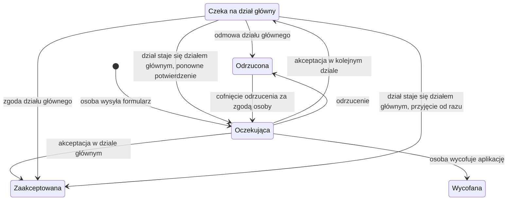

# Rozpatrywanie aplikacji

:::warning[Szkic]
Szkic napisany na podstawie działania wersji 1 i decyzji podjętych przy stronie „Aplikacja wolontariacka”. Opisuje, jak rozpatrywanie aplikacji ma działać.
:::

Rozpatrywanie aplikacji to podjęcie decyzji, czy osoba, która złożyła aplikację wolontariacką, zostaje przyjęta do działu. Ta strona opisuje, kto decyduje, co widzi przy aplikacji, jakie skutki ma decyzja i jak działa pierwszeństwo działu głównego. Formularz i to, co widzi osoba aplikująca, opisuje strona [Aplikacja wolontariacka](../wolontariusz/aplikacja.md).

## Założenia

- Aplikację rozpatruje osoba, której rola na to pozwala. Dalej nazywana jest rozpatrującym.
- Przeglądanie aplikacji i podejmowanie decyzji to osobne uprawnienia. Kto widzi aplikację, nie musi móc jej rozpatrzyć.
- Każda aplikacja dotyczy jednego działu i jest rozpatrywana osobno. System nie pozwala podjąć jednej decyzji dla wielu aplikacji naraz.
- Decyzję można podjąć tylko dla aplikacji oczekującej.
- Dział nie ma limitu miejsc. To, ilu osób dział potrzebuje, ocenia rozpatrujący.
- Przy odrzuceniu rozpatrujący musi podać powód, a osoba go widzi. Notatka wewnętrzna jest osobna i osoba jej nie widzi.
- Rozpatrujący nie usuwa aplikacji. Usuwa je tylko administrator z odpowiednim uprawnieniem albo system przy anonimizacji.
- Gdy osoba aplikuje do kilku działów, dział główny ma pierwszeństwo: aplikacje do pozostałych działów wymagają także jego zgody.
- Odrzucenie można cofnąć tylko za zgodą osoby. Akceptacji cofnąć nie można.
- System zapisuje w dzienniku audytu każdą decyzję, notatkę i usunięcie aplikacji: kto i kiedy.

## Rozpatrywanie a wydarzenie

Rozpatrujący pracuje zawsze w jednym wydarzeniu i widzi tylko jego aplikacje. Aplikacje napływają, dopóki wydarzenie i dział przyjmują zgłoszenia; termin ustawia się w [ustawieniach wydarzenia](../administrator/ustawienia-wydarzenia.md) i w ustawieniach działu. Rozpatrywać można także po terminie.

Rozpatrujący może włączyć sobie powiadomienie o każdej nowej aplikacji.

Wydarzenie ustala też, co dzieje się z aplikacją, która czeka na dział główny, gdy jej dział sam staje się działem głównym (zob. sekcję „Dział główny i pierwszeństwo”).

## Uprawnienia

To, co osoba może zrobić z aplikacjami, wynika z uprawnień jej roli. Przeglądanie aplikacji, wgląd w dane wrażliwe, decyzja w dziale, decyzja w całym wydarzeniu i usuwanie aplikacji to osobne uprawnienia; opisuje je strona [Uprawnienia i role](../administrator/uprawnienia-i-role.md).

## Lista aplikacji

Lista aplikacji pokazuje aplikacje, które osoba może przeglądać. Domyślnie pokazuje tylko aplikacje oczekujące, od najnowszej. Rozpatrujący może:

- szukać po danych osoby i po numerze aplikacji,
- filtrować po stanie, dziale, dacie złożenia oraz po odpowiedziach na pytania z formularza,
- wybrać, które kolumny i filtry są widoczne, oraz sortować listę po dowolnej kolumnie,
- wyeksportować listę do pliku i ją wydrukować.

Lista nie pozwala podjąć decyzji dla wielu aplikacji naraz. Każdą aplikację rozpatruje się pojedynczo.

## Co rozpatrujący widzi przy aplikacji

Dane widoczne przy aplikacji przedstawia tabela 1.

| Dane | Opis |
| --- | --- |
| Osoba | Imię i nazwisko, nickname, adres e-mail, kontakt na Telegramie |
| Dział i zespoły | Dział, wybrane zespoły, miejsce aplikacji w kolejności osoby i informacja, czy to dział główny |
| Odpowiedzi | Odpowiedzi na pytania wydarzenia, działu i zespołów oraz notatka osoby do aplikacji |
| Godziny albo poziom | Godziny zadeklarowane dla tego działu wraz z punktami, które z nich wynikają, i notatką osoby do deklaracji, albo wybrany poziom – zależnie od systemu benefitów wydarzenia |
| Inne aplikacje osoby | Pozostałe aplikacje osoby w tym wydarzeniu, ich stan i zadeklarowane w nich godziny |
| Wybrane zespoły | Opis każdego wybranego zespołu |
| Obecne członkostwa | Działy i zespoły, do których osoba już należy |
| Historia zmian | Poprawki wprowadzone przez osobę: co, kiedy i z jakiej wartości na jaką |
| Decyzja | Kto i kiedy rozpatrzył aplikację, powód odrzucenia, notatka wewnętrzna |

*Tabela 1. Dane widoczne przy aplikacji*

Odpowiedzi na pytania oznaczone jako wrażliwe widzi tylko osoba, która ma jednocześnie dwa uprawnienia: przeglądanie aplikacji i wgląd w dane wrażliwe.

## Decyzja i jej skutki

Rozpatrujący akceptuje aplikację albo ją odrzuca. Skutki przedstawia tabela 2.

| Decyzja | Co się dzieje |
| --- | --- |
| Akceptacja | Powstaje uczestnictwo osoby w wydarzeniu i członkostwo w dziale; przy aplikacji z zespołami także przypisanie do wybranych zespołów. Odpowiedzi z aplikacji trafiają do profilu osoby w tym wydarzeniu i zastępują odpowiedzi, które już tam były. Osoba dostaje wiadomość. |
| Odrzucenie | Rozpatrujący podaje powód – bez niego system nie przyjmuje odrzucenia. Osoba dostaje wiadomość z powodem i może aplikować ponownie. |

*Tabela 2. Skutki decyzji*

Dane profilu są przypisane do wydarzenia, więc akceptacja nie zmienia odpowiedzi osoby w innych wydarzeniach (zob. [Profil wolontariusza](../wolontariusz/profil.md)).

Rozpatrujący widzi po decyzji, czy wiadomość została dostarczona i którym kanałem. Wybór kanału, język wiadomości i ich wyłączanie w wydarzeniu opisuje strona [Kanały i ustawienia powiadomień](../powiadomienia/kanaly-i-ustawienia.md).

Akceptacja blokuje deklarację godzin albo poziom osoby – od tej chwili zmienia je tylko organizator.

Dodawanie osoby do działu bez aplikacji opisuje strona [Działy i zespoły](dzialy-i-zespoly.md).

### Powód odrzucenia i notatka wewnętrzna

Aplikacja ma dwa osobne pola tekstowe:

- powód odrzucenia – obowiązkowy przy odrzuceniu; widzi go osoba aplikująca, w wiadomości i w profilu,
- notatka wewnętrzna – nieobowiązkowa; widzą ją tylko osoby, które mogą przeglądać aplikacje; można ją zapisać w każdej chwili: bez podejmowania decyzji, przy akceptacji i przy odrzuceniu.

## Dział główny i pierwszeństwo

Wolontariusz, który aplikuje do kilku działów i zostaje przyjęty do wszystkich, często nie jest w stanie wypełnić zadeklarowanych godzin w żadnym z nich. Dlatego osoba ustawia swoje aplikacje w kolejności, a dział na pierwszym miejscu – dział główny – ma pierwszeństwo w decyzji:

- aplikacja do działu głównego wymaga jednej zgody – tego działu,
- aplikacja do każdego kolejnego działu wymaga dwóch zgód: tego działu oraz rozpatrującego z działu głównego, który ocenia, czy osobie wystarczy godzin na pracę w kolejnym dziale,
- pozostałe działy mogą rozpatrzyć aplikację wcześniej, ale ich decyzja czeka na dział główny i zaczyna działać dopiero po jego decyzji,
- gdy dział główny odrzuci aplikację albo osoba ją wycofa, działem głównym staje się następny dział w kolejności ustawionej przez osobę – i tak dalej, aż któryś dział ją przyjmie albo skończą się aplikacje.

Gdy rozpatrujący z działu głównego odmówi zgody na kolejny dział, aplikacja do tego działu zostaje odrzucona z powodem „Odrzucona przez rozpatrującego z działu głównego”. Rozpatrujący z działu głównego może dopisać własne uzasadnienie; osoba widzi jedno i drugie.

Aplikacja, którą kolejny dział już zaakceptował, czeka na dział główny. Gdy jej dział sam staje się działem głównym, dalszy ciąg zależy od [ustawień wydarzenia](../administrator/ustawienia-wydarzenia.md):

- przyjęcie od razu – wcześniejsza akceptacja wystarcza i osoba zostaje przyjęta,
- ponowne potwierdzenie – aplikacja wraca do stanu „Oczekująca”, a dział potwierdza decyzję jeszcze raz, już jako dział główny.

Zgodę działu głównego może zastąpić osoba z uprawnieniem do decyzji w całym wydarzeniu.

Informacja o dziale głównym zostaje po przyjęciu: przy członkostwach osoby widać, który dział jest jej działem głównym.

Przykładowo, osoba aplikuje do działów Scena (1), Rejestracja (2) i Magazyn (3). Rejestracja akceptuje aplikację jako pierwsza, ale osoba nie jest jeszcze przyjęta – aplikacja czeka na Scenę. Scena przyjmuje osobę, a jej rozpatrujący zgadza się także na Rejestrację; odmawia zgody na Magazyn, bo osobie nie wystarczy godzin. Gdyby Scena odrzuciła aplikację, działem głównym stałaby się Rejestracja. Zależnie od ustawień wydarzenia jej wcześniejsza akceptacja by wystarczyła albo Rejestracja potwierdziłaby ją ponownie.

## Stany aplikacji widziane przez rozpatrującego

Rozpatrujący widzi te same stany co osoba aplikująca oraz jeden dodatkowy: „Czeka na dział główny”. Osoba widzi taką aplikację nadal jako „Oczekująca”. Stany przedstawia rysunek 1.

*Rys. 1. Stany aplikacji widziane przez rozpatrującego*

## Cofnięcie decyzji

Rozpatrujący może cofnąć odrzucenie, ale tylko za zgodą osoby, której aplikacja dotyczy. System pyta osobę o zgodę; dopiero po niej aplikacja wraca do stanu „Oczekująca”. Bez zgody odrzucenie zostaje.

Akceptacji cofnąć nie można. Osobę, która została przyjęta, usuwa się z działu osobną procedurą (zob. [Działy i zespoły](dzialy-i-zespoly.md)).

## Usuwanie aplikacji

Rozpatrujący nie usuwa aplikacji – może ją tylko odrzucić. Aplikację usuwa całkowicie:

- administrator, którego rola ma uprawnienie do usuwania aplikacji,
- system, gdy dane osoby są anonimizowane (zob. [Anonimizacja i usuwanie danych](../rodo/anonimizacja-i-usuwanie.md)).

## Osoba z listy osób z zakazem wolontariatu

:::note[Do opisania]
Gdy aplikację złoży osoba z listy osób z zakazem wolontariatu, przy aplikacji pojawia się wyraźne ostrzeżenie, a przyjąć ją można dopiero po potwierdzeniu w osobnym oknie.
:::
