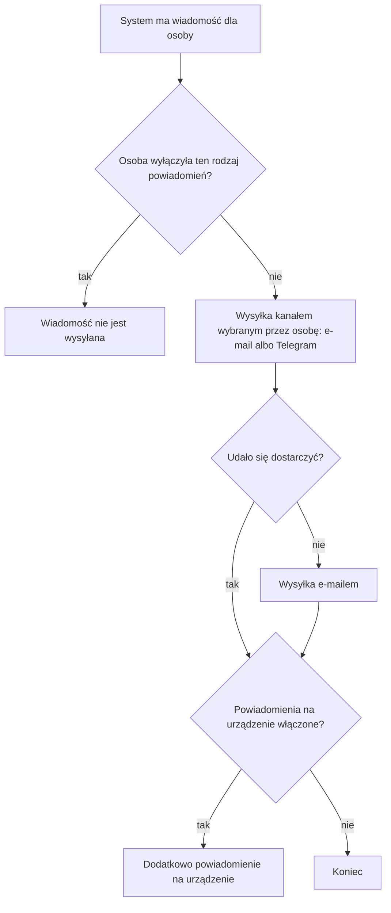

# Kanały i ustawienia powiadomień

:::warning[Szkic]
Sekcje „Droga wiadomości” i „Skrzynka powiadomień” zostały przeniesione ze strony „Sposoby kontaktu”. Pozostałe zasady czekają na opisanie w sekcji „Do opisania”.
:::

Ta strona opisuje, którym kanałem system wysyła osobie wiadomość i gdzie osoba widzi wiadomości, które dostała. To, jakie wiadomości system wysyła, opisuje strona [Rodzaje powiadomień](rodzaje-powiadomien.md).

## Droga wiadomości

Osoba wybiera w profilu kanał powiadomień: e-mail albo Telegram. Telegram można wybrać dopiero po połączeniu konta (zob. [Telegram](../integracje-zewnetrzne/telegram.md)). Drogę wiadomości przedstawia rysunek 1.

*Rys. 1. Droga wiadomości od systemu do osoby*

Gdy wiadomości nie da się dostarczyć wybranym kanałem, np. osoba zablokowała bota na Telegramie, system wysyła ją e-mailem. E-mail jest zawsze ostatnią drogą dostarczenia.

Kod logowania przychodzi kanałem wybranym przez osobę, tak jak inne wiadomości (zob. [Rejestracja i logowanie](../wolontariusz/rejestracja-i-logowanie.md#logowanie-kodem)). Kod potwierdzający adres e-mail w aplikacji wolontariackiej przychodzi zawsze e-mailem.

Powiadomienie na urządzenie jest dodatkiem do wybranego kanału, a nie osobnym kanałem. Osoba włącza je osobno na każdym urządzeniu. Może to zrobić w przeglądarce; nie musi instalować systemu jako aplikacji. Powiadomienie po kliknięciu otwiera stronę systemu, której dotyczy.

Wiadomość e-mail, której rodzaj da się wyłączyć, zawiera odnośnik do ustawień powiadomień.

## Skrzynka powiadomień

Skrzynka powiadomień pokazuje w systemie wiadomości wysłane do osoby wszystkimi kanałami, także te, których nie udało się dostarczyć. Osoba widzi w niej treść każdej wiadomości i to, czy ją przeczytała; licznik nieprzeczytanych wiadomości jest widoczny na każdej stronie.

Każde powiadomienie ma tytuł adekwatny do treści, tak aby osoba wiedziała, czego dotyczy, bez otwierania wiadomości.

Skrzynka nie pokazuje kodów logowania ani kodów potwierdzających.

System przechowuje wiadomości w skrzynce 365 dni. Osoba może wcześniej usunąć te, które sama wybierze.

## Do opisania

:::note[Do opisania]
Zasady opisane dotąd na innych stronach:

- wiadomość jest w języku osoby; język osoba wybiera przy rejestracji i może go zmienić w każdej chwili,
- wysyłający widzi, czy wiadomość została dostarczona i którym kanałem,
- wydarzenie może wyłączyć wybrany rodzaj wiadomości, np. o akceptacji albo o odrzuceniu aplikacji,
- odnośnik z powiadomienia otwiera konkretną stronę systemu; osoba niezalogowana najpierw się loguje,
- osoba może wysłać na urządzenie powiadomienie próbne,
- rozłączenie Telegrama przywraca e-mail jako kanał powiadomień,
- opcja „preferowany kanał” w Mailerze wysyła wiadomość kanałem wybranym przez osobę (zob. [Mailer](../organizator/mailer.md)).

Źródła: [Rozpatrywanie aplikacji](../organizator/rozpatrywanie-aplikacji.md), [Rejestracja i logowanie](../wolontariusz/rejestracja-i-logowanie.md), [Sposoby kontaktu](../wolontariusz/sposoby-kontaktu.md).
:::
