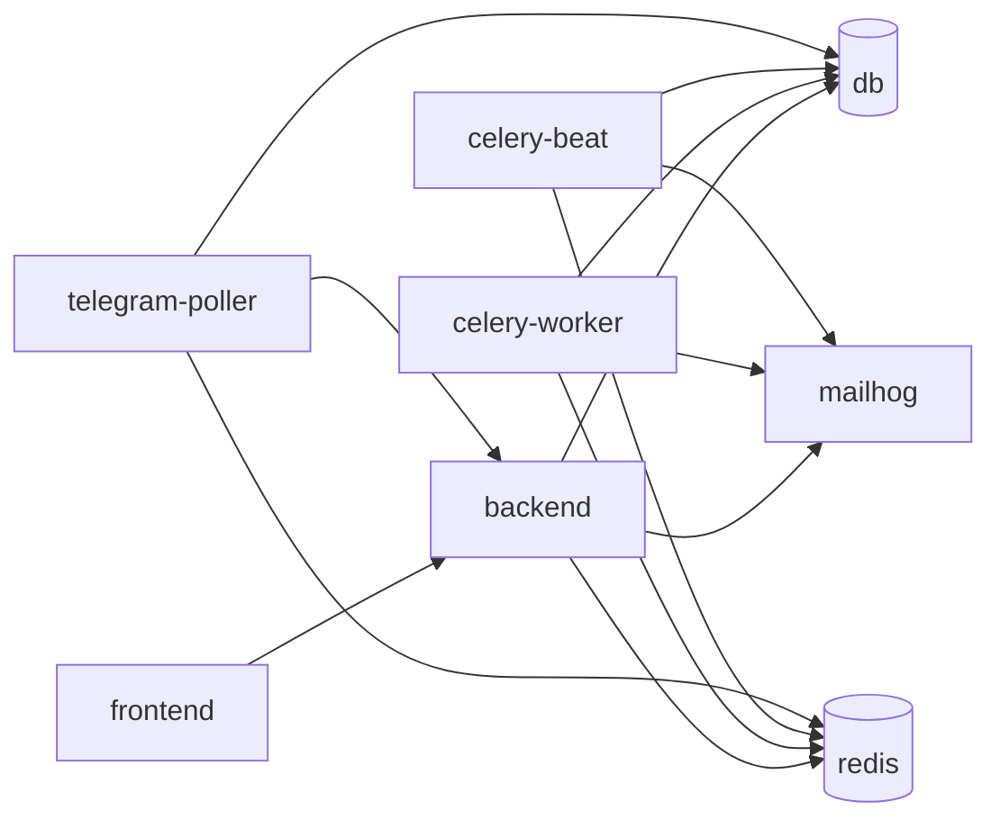

# Przegląd architektury

:::warning[Szkic]
Strona jest szkieletem. Diagram pokazuje usługi i zależności `depends_on` z `docker-compose.yml`; pozostałe sekcje czekają na treść.
:::

## Usługi

TODO(pytanie): opisać rolę każdej usługi.

## Moduły backendu

TODO(pytanie): lista aplikacji Django z `backend/` i ich odpowiedzialności.

## Integracje zewnętrzne

TODO(pytanie): Foxcons, Telegram, OAuth/OIDC, poczta.
