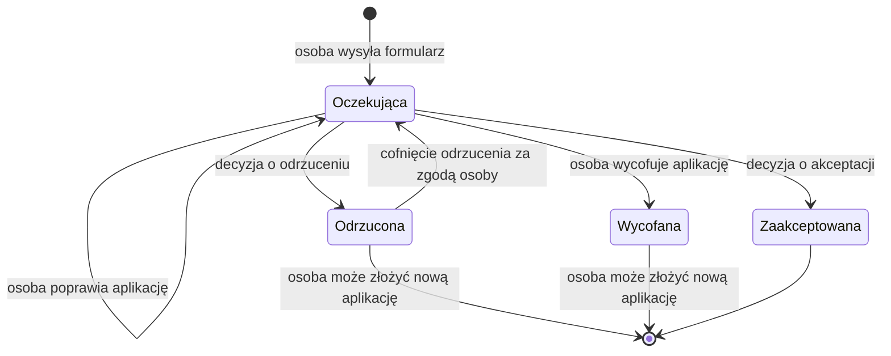

# Aplikacja wolontariacka

Aplikacja wolontariacka to zgłoszenie osoby, która chce zostać wolontariuszem w dziale lub zespole na wybranym wydarzeniu. Ta strona opisuje, kto i kiedy może aplikować, co zawiera formularz, jakie stany ma aplikacja i co osoba widzi po jej wysłaniu. Podejmowanie decyzji opisuje strona [Rozpatrywanie aplikacji](../organizator/rozpatrywanie-aplikacji.md).

## Założenia

- Aplikacja dotyczy jednego wydarzenia i jednego działu. Osoba, która wybiera kilka działów, składa jednym formularzem kilka aplikacji, a każda jest rozpatrywana osobno.
- Aplikować może osoba bez konta i osoba zalogowana. Osoba bez konta potwierdza adres e-mail kodem, a konto powstaje razem z aplikacją (zob. [Rejestracja i logowanie](rejestracja-i-logowanie.md)).
- Formularz zależy od wydarzenia i od wybranych działów: każdy dział i zespół może mieć własny opis i własne pytania.
- Aplikacja wymaga decyzji. Dopiero akceptacja daje osobie uczestnictwo w wydarzeniu i członkostwo w dziale.
- Decyzję podejmuje osoba, której rola pozwala rozpatrywać aplikacje.
- Osoba, która aplikuje do kilku działów, ustawia je w kolejności. Pierwszy dział jest działem głównym i ma pierwszeństwo: aplikacje do pozostałych działów wymagają także zgody działu głównego. Chroni to wolontariuszy przed przyjęciem do zbyt wielu działów naraz.
- Osoba może mieć w jednym dziale tylko jedną oczekującą aplikację i nie może aplikować do działu, którego już jest członkiem.
- Do czasu decyzji osoba może poprawić albo wycofać aplikację. Rozpatrujący widzi historię poprawek.
- Osoba poznaje powód odrzucenia. Po odrzuceniu może aplikować ponownie.
- Odrzucenie można cofnąć tylko za zgodą osoby, której dotyczy. Akceptacji cofnąć nie można – przyjętą osobę usuwa się z działu.
- Wydarzenie i dział przyjmują aplikacje do ustalonego terminu. Po terminie system nie przyjmuje aplikacji żadną drogą.
- Zgoda RODO wyrażona w formularzu jest zapisywana razem z aplikacją.
- Osoba dostaje wiadomości o aplikacji w swoim języku.

## Aplikacja a wydarzenie

Osoba aplikuje zawsze na konkretne wydarzenie. O tym, czy i jak można aplikować, decydują [ustawienia wydarzenia](../administrator/ustawienia-wydarzenia.md):

- czy wydarzenie jest otwarte na aplikacje i do kiedy,
- czy może aplikować osoba bez konta,
- czy może aplikować osoba zalogowana,
- do ilu działów najwięcej może aplikować jedna osoba,
- czy osoba w formularzu deklaruje godziny w karcie godzin, wybiera poziom, czy nie deklaruje niczego.

O tym, do czego można aplikować, decydują ustawienia działów (zob. [Działy i zespoły](../organizator/dzialy-i-zespoly.md)):

- dział może mieć własny termin aplikacji, wcześniejszy niż termin wydarzenia; po nim formularz pokazuje dział jako zamknięty,
- dział może być wyłączony z aplikacji – wtedy osoby dodaje do niego tylko organizator lub administrator, a formularz go nie pokazuje,
- dział może pozwalać na wybór zespołów; zespół pojawia się w formularzu, gdy jest oznaczony jako dostępny do wyboru,
- dział pokazuje w formularzu swój opis oraz osoby kontaktowe: organizatora, koordynatora i członków, którzy udostępnili swoje dane kontaktowe.

Osoba, która już uczestniczy w wydarzeniu, aplikuje do kolejnego działu tym samym formularzem.

## Formularz aplikacji

Formularz prowadzi osobę przez kolejne kroki. Kroki przedstawia tabela 1.

| Krok | Co osoba podaje | Uwagi |
| --- | --- | --- |
| Dane | Wydarzenie, adres e-mail, imię i nazwisko, nickname, kontakt na Telegramie | Osobie zalogowanej system podstawia dane z profilu; adres e-mail musi być adresem jej konta |
| Działy | Jeden lub więcej działów, opcjonalnie zespoły w wybranych działach; przy kilku działach także ich kolejność | Dział, w którym osoba ma oczekującą lub zaakceptowaną aplikację, jest zablokowany |
| Pytania | Odpowiedzi na pytania wydarzenia, wybranych działów i zespołów oraz opcjonalną notatkę do aplikacji | Pytania to pola niestandardowe |
| Deklaracja godzin albo wybór poziomu | Godziny deklarowane osobno dla każdego wybranego działu albo poziom wybrany dla każdej aplikacji | Zależnie od systemu benefitów wydarzenia; kroku nie ma, gdy wydarzenie nie liczy godzin |
| Podsumowanie | Zgodę RODO | Osoba sprawdza wszystkie odpowiedzi przed wysłaniem |

*Tabela 1. Kroki formularza aplikacji*

Formularz zapamiętuje na urządzeniu niedokończoną aplikację, osobno dla każdego wydarzenia. Osoba może przerwać wypełnianie i wrócić do niego później.

### Wybór działów i zespołów

Osoba może wybrać kilka działów naraz, najwyżej tyle, ile pozwala wydarzenie. Do limitu liczą się działy, których osoba już jest członkiem, oraz jej aplikacje oczekujące; aplikacje odrzucone i wycofane się nie liczą. Dla każdego wybranego działu powstaje jedna aplikacja. Zespoły wybrane w dziale są listą w tej aplikacji, a nie osobnymi aplikacjami. Nie można aplikować do zespołu bez jego działu.

Osoba, która wybiera więcej niż jeden dział, ustawia aplikacje w kolejności od najważniejszej. Dział na pierwszym miejscu jest działem głównym. Skutki kolejności opisuje sekcja „Dział główny”.

### Pytania działów

Pytania w formularzu to [pola niestandardowe](../administrator/pola-niestandardowe.md). Formularz pokazuje tylko pola pasujące do działów i zespołów wybranych przez osobę.

Pytanie wspólne dla kilku wybranych działów pojawia się raz. Osobie zalogowanej system podstawia odpowiedzi, które ma już w profilu tego wydarzenia. Po akceptacji aplikacji odpowiedzi trafiają do profilu osoby w tym wydarzeniu i zastępują te, które już tam były.

### Deklaracja godzin i wybór poziomu

W formularzu osoba określa, ile zamierza pracować. Wydarzenie może nie korzystać z deklaracji ani z liczenia godzin – wtedy formularz nie ma tego kroku. W pozostałych przypadkach wydarzenie korzysta z jednego z dwóch systemów:

- karta godzin – osoba deklaruje godziny osobno dla każdego działu, do którego aplikuje, w podziale na czas przed wydarzeniem, w jego trakcie i po nim; zasady opisuje strona [Benefity oparte na karcie godzin](../benefity/karta-godzin.md),
- poziomy – osoba wybiera jeden z poziomów zdefiniowanych z góry; lista poziomów jest wspólna dla wydarzenia, a wybrany poziom jest przypisany do konkretnej aplikacji; zasady opisuje strona [Poziomy benefitów](../benefity/poziomy-benefitow.md).

Po akceptacji aplikacji osoba nie zmienia już sama deklaracji ani poziomu.

## Wysłanie aplikacji

Sposób wysłania zależy od tego, czy osoba jest zalogowana:

- osoba zalogowana wysyła aplikację od razu z podsumowania,
- osoba bez konta dostaje na podany adres e-mail kod i wpisuje go w formularzu; dopiero wtedy system zapisuje aplikację i, jeśli trzeba, zakłada konto.

Kod działa tak jak kod logowania (zob. [Rejestracja i logowanie](rejestracja-i-logowanie.md#logowanie-kodem)). Potwierdzenie kodem nie loguje osoby.

Po wysłaniu osoba widzi potwierdzenie na ekranie i dostaje wiadomość e-mail z listą działów, do których aplikowała.

## Stany aplikacji

Aplikacja ma cztery stany widoczne dla osoby. Przejścia między nimi przedstawia rysunek 1. Stany widziane przez rozpatrującego opisuje strona [Rozpatrywanie aplikacji](../organizator/rozpatrywanie-aplikacji.md).

*Rys. 1. Stany aplikacji wolontariackiej*

Skutki każdego stanu przedstawia tabela 2.

| Stan | Co oznacza | Co się dzieje |
| --- | --- | --- |
| Oczekująca | Aplikacja czeka na decyzję | Osoba widzi ją w profilu i może ją poprawić albo wycofać; nie ma jeszcze dostępu do spraw wydarzenia |
| Wycofana | Osoba zrezygnowała przed decyzją | Aplikacja nie jest rozpatrywana; osoba może aplikować ponownie |
| Zaakceptowana | Osoba została przyjęta do działu | Osoba dostaje wiadomość i dostęp do spraw wydarzenia; staje się członkiem działu i wybranych zespołów |
| Odrzucona | Osoba nie została przyjęta do działu | Osoba dostaje wiadomość z powodem odrzucenia i może aplikować ponownie |

*Tabela 2. Stany aplikacji i ich skutki*

### Dział główny

Kolejność działów ma znaczenie. Dział główny decyduje jako pierwszy, a aplikacje do pozostałych działów wymagają także jego zgody. Aplikację, która czeka na dział główny, osoba widzi jako „Oczekująca”. Gdy dział główny odrzuci aplikację albo osoba ją wycofa, działem głównym staje się następny dział w kolejności. Reguły opisuje strona [Rozpatrywanie aplikacji](../organizator/rozpatrywanie-aplikacji.md#dział-główny-i-pierwszeństwo).

### Cofnięcie odrzucenia

Gdy rozpatrujący chce cofnąć odrzucenie, system pyta osobę o zgodę. Dopiero po niej aplikacja wraca do stanu „Oczekująca”. Akceptacji cofnąć nie można.

## Co widzi osoba po wysłaniu

- W profilu osoba widzi swoje aplikacje i ich stan.
- Na liście działów każdy dział pokazuje stan aplikacji osoby: oczekująca, wycofana, zaakceptowana albo odrzucona.
- O decyzji osoba dowiaduje się z wiadomości wysłanej kanałem, który wybrała dla powiadomień. Przy odrzuceniu wiadomość i profil pokazują powód.
- Do czasu pierwszej akceptacji osoba widzi tylko profil i stan aplikacji, bez spraw wydarzenia.

Formularz nie pyta o przyjazd i wyjazd. Osoba podaje je po przyjęciu (zob. [Niedyspozycyjność, przyjazd i wyjazd](niedyspozycyjnosc-przyjazd-wyjazd.md)).
