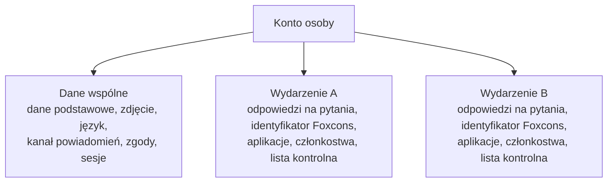

# Profil wolontariusza

Profil wolontariusza to miejsce, w którym osoba widzi i zmienia swoje dane oraz sprawdza, co jeszcze musi zrobić przed wydarzeniem. Ta strona opisuje, co profil zawiera, które dane osoba zmienia sama, a które zmienia administrator, oraz jak profil zależy od wydarzenia.

## Założenia

- Każda osoba z kontem ma profil. Profil widzi i zmienia sama osoba; organizator i administrator widzą jej dane na liście wolontariuszy.
- Dane podstawowe są wspólne dla konta. Odpowiedzi na pytania i identyfikator Foxcons są przypisane do wydarzenia – osoba ma je osobno dla każdego wydarzenia.
- Dane podstawowe można rozszerzać o własne pola systemowe, wspólne dla konta, np. PESEL. Osoba może je uzupełnić w profilu później. Pytania dotyczące jednego wydarzenia definiuje się dla wydarzenia.
- Dane podstawowe osoba wpisuje raz. Po pierwszym wprowadzeniu nie zmienia ich sama – prosi o zmianę organizatora.
- Odpowiedzi na pytania osoba zmienia do terminu ustalonego przez wydarzenie.
- Brak wymaganej odpowiedzi nie blokuje korzystania z systemu. Widać go na liście kontrolnej.
- Akceptacja aplikacji wolontariackiej wpisuje odpowiedzi z aplikacji do profilu osoby w tym wydarzeniu i zastępuje te, które już tam były.
- Osoba nie zmienia sama adresu e-mail konta. Zmienia go administrator.
- Pełne korzystanie z systemu wymaga uzupełnionych danych podstawowych i ważnej zgody RODO.
- Osoba sama decyduje, czy inni wolontariusze widzą jej adres e-mail i kontakt na Telegramie. Domyślnie ich nie widzą.
- Osoba wybiera kanał powiadomień i język. System wysyła wiadomości tym kanałem i w tym języku.
- Osoba widzi, na jakich urządzeniach jest zalogowana, i może wylogować pozostałe.
- Notatki wewnętrznej o osobie, pisanej przez organizatorów, osoba nie widzi.

## Profil a wydarzenie

Profil łączy dane dwóch rodzajów: wspólne dla konta i przypisane do wybranego wydarzenia. Podział przedstawia rysunek 1.

*Rys. 1. Dane wspólne dla konta i dane przypisane do wydarzenia*

Osoba ogląda profil zawsze w kontekście wybranego wydarzenia. Zmiana danych wspólnych działa we wszystkich wydarzeniach; zmiana odpowiedzi albo identyfikatora Foxcons dotyczy tylko wybranego wydarzenia.

Wydarzenie ustala termin, do którego osoba może zmieniać swoje odpowiedzi (zob. [Ustawienia wydarzenia](../administrator/ustawienia-wydarzenia.md)). Profil pokazuje ten termin. Po nim odpowiedzi zmienia tylko organizator.

Osoba, która nie ma uczestnictwa w wybranym wydarzeniu, widzi w profilu informację, że nie jest zapisana na wydarzenie, oraz swoje aplikacje i ich stan.

## Co zawiera profil

Części profilu przedstawia tabela 1.

| Część | Co pokazuje | Co osoba może zrobić |
| --- | --- | --- |
| Aplikacje | Aplikacje osoby w wydarzeniu, ich stan i powód odrzucenia | Poprawić albo wycofać aplikację oczekującą; zgodzić się na cofnięcie odrzucenia |
| Lista kontrolna | Co osoba musi jeszcze zrobić przed wydarzeniem i ile już zrobiła | Przejść do brakującego kroku |
| Zdjęcie profilowe | Zdjęcie osoby | Dodać, zmienić, usunąć |
| Dane podstawowe | Imię i nazwisko, nickname, adres e-mail, kontakt na Telegramie | Wpisać dane, których jeszcze nie ma; zmienia je organizator |
| Identyfikator Foxcons | Identyfikator osoby w Foxcons dla wybranego wydarzenia | Wpisać go ręcznie, gdy system nie znalazł go sam |
| Członkostwa | Działy i zespoły osoby oraz jej dział główny | – |
| Odpowiedzi na pytania | Odpowiedzi na pola niestandardowe wydarzenia | Zmienić odpowiedzi, które wydarzenie pozwala zmieniać |
| Kontakt i powiadomienia | Połączenie z Telegramem, kanał powiadomień, udostępnianie kontaktu | Połączyć i rozłączyć Telegram, wybrać kanał, włączyć udostępnianie |
| Język i ustawienia lokalizacyjne | Język interfejsu i wiadomości oraz format zapisu, np. daty | Zmienić język i format |
| Sesje | Urządzenia, na których osoba jest zalogowana | Zakończyć wybraną sesję albo wszystkie poza bieżącą |
| Zgody | Stan zgody RODO i zgody na dłuższe przetwarzanie danych | Wyrazić zgodę |

*Tabela 1. Części profilu*

Obok profilu osoba ma osobne strony: [Historia wolontariatu](historia.md), [Umowy i dokumenty](umowy-i-dokumenty.md) oraz [Benefity i karta godzin](benefity-i-karta-godzin.md).

## Dane podstawowe

Dane podstawowe przedstawia tabela 2.

| Dane | Kto zmienia | Uwagi |
| --- | --- | --- |
| Imię i nazwisko | Osoba wpisuje raz, potem organizator | Wymagane |
| Nickname | Osoba wpisuje raz, potem organizator | Wymagany; dwie osoby nie mogą mieć tego samego nicknamu, bez względu na wielkość liter |
| Adres e-mail | Administrator | Osoba go widzi, ale nie zmienia |
| Kontakt na Telegramie | Osoba | Wymagany: nazwa użytkownika albo połączenie konta z Telegramem; po połączeniu nazwę ustawia Telegram |
| Pola systemowe | Osoba wpisuje raz, potem organizator | Np. PESEL; osoba może je uzupełnić później |
| Stały członek organizacji | Osoba | Osoba oznacza się sama; osoba, której rola na to pozwala, może to oznaczenie nadpisać, np. gdy ktoś zostaje wyrzucony z organizacji |
| Stan konta | Administrator albo system | Aktywne albo nieaktywne (zob. [Rejestracja i logowanie](rejestracja-i-logowanie.md)) |

*Tabela 2. Dane podstawowe*

Dane podstawowe osoba wpisuje raz. Po pierwszym wprowadzeniu nie może ich sama zmienić; gdy chce je poprawić, kontaktuje się z organizatorem, a zmianę wprowadza organizator. Dotyczy to także pól systemowych. Połączenie konta z Telegramem osoba zmienia sama (zob. sekcję „Kontakt i powiadomienia”).

Imię i nazwisko, nickname i kontakt na Telegramie są wymagane razem z ważną zgodą RODO. Gdy którejś z tych rzeczy brakuje, system prowadzi osobę do uzupełnienia profilu, zanim pokaże cokolwiek innego.

Dane podstawowe można rozszerzyć o pola systemowe – [pola niestandardowe](../administrator/pola-niestandardowe.md) wspólne dla konta, a nie dla jednego wydarzenia. Przykładowo, PESEL jest polem systemowym: osoba podaje go raz i obowiązuje we wszystkich wydarzeniach. Pole systemowe nie musi być wypełnione przy pierwszym logowaniu; osoba uzupełnia je w profilu później.

Imię, nazwisko i adres e-mail osoby widzą tylko organizatorzy jej działów i administrator. Pozostali wolontariusze widzą nickname.

## Identyfikator Foxcons

Identyfikator Foxcons łączy osobę z jej rejestracją w Foxcons. Jest przypisany do wydarzenia: osoba ma osobny identyfikator dla każdego wydarzenia. System szuka go w Foxcons po adresie e-mail osoby; osoba wpisuje identyfikator ręcznie tylko wtedy, gdy system go nie znalazł. Zasady opisuje strona [Foxcons](../integracje-zewnetrzne/foxcons.md).

## Odpowiedzi na pytania

Odpowiedzi na pytania to wartości [pól niestandardowych](../administrator/pola-niestandardowe.md), np. rozmiar koszulki albo dieta. Profil pokazuje pola, które wydarzenie oznaczyło jako widoczne w profilu i które pasują do działów i zespołów osoby. To, czy osoba może zmienić odpowiedź i czy odpowiedź jest wymagana, ustala się dla każdego pola. Osoba zmienia odpowiedzi do terminu ustalonego przez wydarzenie; po nim zmienia je tylko organizator. Brak wymaganej odpowiedzi nie blokuje korzystania z systemu – widać go na liście kontrolnej.

Odpowiedzi osoba podaje po raz pierwszy w aplikacji wolontariackiej. Po akceptacji trafiają do profilu w tym wydarzeniu (zob. [Rozpatrywanie aplikacji](../organizator/rozpatrywanie-aplikacji.md)).

Odpowiedź na pole wrażliwe profil pokazuje zasłoniętą; osoba odsłania ją sama.

## Lista kontrolna

Lista kontrolna pokazuje, co osoba musi zrobić przed wydarzeniem, i jaką część już zrobiła. Wydarzenie wybiera, których kroków używa. Dostępne kroki zależą od modułów i wymagań wydarzenia: krok dotyczący umowy jest dostępny tylko wtedy, gdy wydarzenie wymaga umowy, a krok dotyczący benefitów tylko wtedy, gdy korzysta z benefitów. Lista może zawierać następujące kroki:

- rejestracja na wydarzenie – osoba ma uczestnictwo,
- zgoda RODO,
- umowa wolontariacka – gdy wydarzenie jej wymaga,
- identyfikator Foxcons,
- członkostwo w co najmniej jednym dziale,
- uzupełnione dane podstawowe i wymagane odpowiedzi,
- połączenie konta z Telegramem,
- zdjęcie profilowe,
- wybór benefitów.

## Zdjęcie profilowe

Osoba dodaje, zmienia i usuwa zdjęcie profilowe. Zdjęcie widzą zalogowani wolontariusze wydarzenia – ci sami, którzy widzą listę wolontariuszy. Osoba niezalogowana ani osoba spoza wydarzenia go nie zobaczy, także wtedy, gdy zna adres pliku. Gdy osoba połączy konto z Telegramem i nie ma zdjęcia, system używa jej zdjęcia z Telegrama.

## Kontakt i powiadomienia

W profilu osoba ustawia, jak system i inni wolontariusze mogą się z nią kontaktować: łączy konto z Telegramem, wybiera kanał i rodzaje powiadomień, włącza powiadomienia na urządzenie, ustawia pory przypomnień o zmianie oraz decyduje o udostępnianiu kontaktu. Ustawienia te i to, kto widzi kontakt osoby, opisuje strona [Sposoby kontaktu](sposoby-kontaktu.md).

## Język i ustawienia lokalizacyjne

Osoba wybiera język przy rejestracji i może go zmienić w każdej chwili. Język dotyczy interfejsu i wszystkich wiadomości, które system wysyła osobie.

Obok języka osoba ustawia sposób zapisu danych zależnych od kraju, np. format daty. Ustawienia lokalizacyjne działają tak samo jak język: w interfejsie i w wiadomościach.

## Sesje

Profil pokazuje listę sesji osoby: urządzenie i czas ostatniego użycia. Osoba może zakończyć wybraną sesję albo wszystkie poza bieżącą (zob. [Rejestracja i logowanie](rejestracja-i-logowanie.md#sesja-i-wylogowanie)).

## Aplikacje i członkostwa

Profil pokazuje aplikacje osoby w wybranym wydarzeniu i ich stan. Aplikację oczekującą osoba może poprawić albo wycofać; przy odrzuconej widzi powód. Gdy rozpatrujący chce cofnąć odrzucenie, osoba wyraża zgodę w profilu (zob. [Aplikacja wolontariacka](aplikacja.md)).

Profil pokazuje też członkostwa osoby: działy, zespoły i to, który dział jest jej działem głównym (zob. [Działy i zespoły](../organizator/dzialy-i-zespoly.md)).

## Zgody

Profil pokazuje, czy osoba ma ważną zgodę RODO. Dopóki jej nie ma, profil pokazuje formularz zgody. Razem ze zgodą RODO osoba decyduje o zgodzie na dłuższe przetwarzanie danych, która chroni konto przed wyłączeniem przez system. Zgody opisuje strona [Zgoda RODO](../rodo/zgoda-rodo.md).

Osoba nie pobiera sama swoich danych, nie wycofuje zgody i nie usuwa danych w profilu. Robi to administrator na jej prośbę (zob. [Anonimizacja i usuwanie danych](../rodo/anonimizacja-i-usuwanie.md)).
