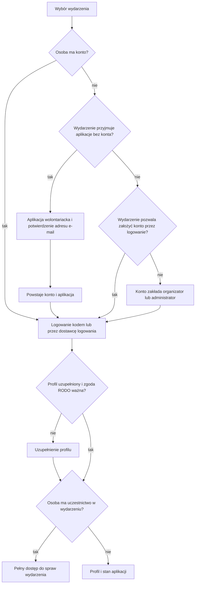

# Rejestracja i logowanie

Rejestracja i logowanie odpowiadają za to, żeby każda osoba miała w systemie jedno konto i mogła z niego korzystać bez hasła. Ta strona opisuje, jak konto powstaje, jak wygląda logowanie i co musi się wydarzyć, zanim nowa osoba zacznie korzystać z systemu na wydarzeniu.

## Założenia

- Jedna osoba ma jedno konto, wspólne dla wszystkich wydarzeń. Konto rozpoznaje się po adresie e-mail.
- Konto nie ma hasła. Osoba loguje się kodem logowania wysłanym na jej adres e-mail albo przez dostawcę logowania.
- System nie ma osobnego formularza rejestracji. Konto powstaje przy pierwszej czynności, która go wymaga: przy aplikacji wolontariackiej, przy pierwszym logowaniu albo wtedy, gdy osobę doda organizator lub administrator.
- Dostawca logowania nie zakłada kont. Loguje tylko do konta, które już istnieje, i dopasowuje je wyłącznie po adresie e-mail.
- Strona logowania nie zdradza, czy podany adres e-mail ma konto.
- Osoba wybiera język przy rejestracji i może go zmienić w każdej chwili. System pokazuje interfejs i wysyła wiadomości w tym języku.
- Osoba widzi, na jakich urządzeniach jest zalogowana, i może wylogować pozostałe urządzenia.
- System sam wyłącza osobę w wydarzeniu po terminie ustalonym przez administratora, a całe konto wtedy, gdy osoba nie jest już w żadnym wydarzeniu.
- Konto to nie to samo co uczestnictwo. Konto pozwala się zalogować; uczestnictwo w wydarzeniu daje dostęp do spraw tego wydarzenia.
- Logowanie wygląda tak samo dla wolontariusza, organizatora i administratora. To, co osoba widzi po zalogowaniu, wynika z jej uprawnień, a nie ze sposobu logowania.
- Przed pierwszym użyciem systemu osoba musi uzupełnić podstawowe dane profilu i wyrazić zgodę RODO.
- Wolontariusz nie zmienia sam adresu e-mail konta. Zmienia go administrator.

## Konto a wydarzenie

Konto jest jedno, ale osoba zawsze pracuje w systemie w kontekście wybranego wydarzenia. Wydarzenie wybiera się przed logowaniem; kod logowania i odnośnik z wiadomości prowadzą z powrotem do tego samego wydarzenia.

Wydarzenie decyduje o tym, kto może do niego dołączyć:

- czy osoba bez konta może złożyć aplikację wolontariacką,
- czy osoba zalogowana może złożyć aplikację wolontariacką,
- czy nieznany adres e-mail może założyć konto przez samo logowanie,
- czy administrator tworzy jej konto,
- do kiedy wydarzenie przyjmuje aplikacje.

Osoba zalogowana, która nie ma uczestnictwa w wybranym wydarzeniu, widzi swój profil, informację, że nie jest zapisana na wydarzenie, oraz swoje aplikacje i ich stan. Nie widzi zmian, benefitów, karty godzin ani centrum informacji tego wydarzenia.

Uczestnictwo powstaje na dwa sposoby: gdy aplikacja wolontariacka zostanie zaakceptowana albo gdy organizator lub administrator doda osobę do wydarzenia. Organizator może też usunąć osobę z wydarzenia. Kończy to jej uczestnictwo, ale nie wyłącza konta.

## Rejestracja – jak powstaje konto

Sposoby powstania konta przedstawia tabela 1.

| Sposób | Kto zaczyna | Co powstaje |
| --- | --- | --- |
| Aplikacja wolontariacka | Osoba bez konta wypełnia formularz aplikacji i potwierdza adres e-mail kodem | Konto z danymi z formularza oraz aplikacja oczekująca na rozpatrzenie |
| Pierwsze logowanie | Osoba podaje adres e-mail, którego system nie zna, na wydarzeniu, które na to pozwala | Konto z samym adresem e-mail; resztę danych osoba podaje przy pierwszym logowaniu |
| Dodanie przez organizatora lub administratora | Organizator lub administrator podaje adres e-mail osoby | Konto i wiadomość z zaproszeniem; przy dodaniu do wydarzenia także uczestnictwo |

*Tabela 1. Sposoby powstania konta*

Potwierdzenie adresu e-mail w aplikacji wolontariackiej nie loguje osoby. Po wysłaniu aplikacji osoba loguje się osobno. Formularz i rozpatrywanie aplikacji opisuje strona [Aplikacja wolontariacka](aplikacja.md).

## Logowanie

Osoba loguje się na jeden z dwóch sposobów: kodem logowania albo przez dostawcę logowania.

### Logowanie kodem

1. Osoba wybiera wydarzenie i podaje adres e-mail.
2. System wysyła wiadomość z kodem logowania i odnośnikiem, w języku osoby. Strona logowania pokazuje ten sam komunikat bez względu na to, czy adres ma konto: „jeśli konto istnieje, wysłaliśmy kod”.
3. Osoba otwiera odnośnik albo wpisuje kod na stronie logowania.
4. System loguje osobę i otwiera wybrane wydarzenie.

Gdy osoba niezalogowana otworzy odnośnik do konkretnej strony systemu, np. z powiadomienia, system najpierw prosi o zalogowanie, a potem otwiera tę stronę.

Kod logowania spełnia następujące warunki:

- jest ważny przez krótki czas (15 minut),
- działa tylko raz,
- liczba próśb o kod i prób jego wpisania w ciągu minuty jest ograniczona.

Osoba, która połączyła konto z Telegramem, może dostawać kod także tam. Włącza to w profilu albo zaznacza przy logowaniu.

### Logowanie przez dostawcę logowania

Dostawca logowania to zewnętrzna usługa, która potwierdza tożsamość osoby. Listę dostawców ustawia administrator. Przykładowo, dostawca Login Hub pozwala zalogować się kontem Foxcons.

1. Osoba wybiera dostawcę na stronie logowania.
2. Dostawca potwierdza jej tożsamość i przekazuje systemowi adres e-mail.
3. System szuka konta z tym adresem. Gdy je znajdzie, loguje osobę. Gdy go nie ma, odmawia i informuje, że konto nie istnieje. Nie zdradza to cudzych danych, bo osoba potwierdziła u dostawcy, że adres należy do niej.

Szczegóły połączenia opisuje strona [OIDC](../integracje-zewnetrzne/oidc.md).

### Sesja i wylogowanie

Po zalogowaniu osoba pozostaje zalogowana na danym urządzeniu. Sesja odnawia się sama, gdy osoba korzysta z systemu, i wygasa po 30 dniach bez użycia. Wylogowanie kończy sesję na urządzeniu i unieważnia ją w systemie; gdy osoba logowała się przez dostawcę logowania, kończy także sesję u dostawcy.

W profilu osoba widzi listę swoich sesji: urządzenie i czas ostatniego użycia. Może zakończyć wybraną sesję albo wszystkie poza bieżącą.

## Pierwsze logowanie

Przy pierwszym logowaniu system prosi o uzupełnienie profilu, zanim pokaże cokolwiek innego. Osoba musi podać:

- język,
- imię i nazwisko,
- nickname,
- kontakt na Telegramie – nazwę użytkownika albo połączenie konta z Telegramem,
- zgodę RODO.

Język jest wstępnie ustawiony na ten, w którym osoba korzystała ze strony logowania lub formularza aplikacji. Pola niestandardowe nie są częścią pierwszego logowania – osoba wypełnia je w aplikacji wolontariackiej i w profilu.

Zgody opisuje strona [Zgoda RODO](../rodo/zgoda-rodo.md), a pozostałe dane profilu strona [Profil wolontariusza](profil.md).

System sprawdza te warunki przy każdym wejściu. Gdy zgoda RODO wygaśnie albo zabraknie wymaganych danych, osoba wraca do uzupełnienia profilu.

Drogę nowej osoby od wyboru wydarzenia do korzystania z systemu przedstawia rysunek 1.

*Rys. 1. Droga od wyboru wydarzenia do korzystania z systemu*

## Konto nieaktywne

Wyłączenie działa na dwóch poziomach:

- osoba wyłączona w wydarzeniu traci dostęp do jego spraw, ale nadal może się zalogować i korzystać z innych wydarzeń,
- konto nieaktywne nie pozwala korzystać z systemu.

Konto wyłącza tylko administrator albo system. Kiedy system wyłącza osobę lub konto i co przed tym chroni, opisuje strona [Anonimizacja i usuwanie danych](../rodo/anonimizacja-i-usuwanie.md).

### Powrót do systemu

To, jak osoba wraca do systemu, zależy od tego, kto wyłączył konto:

- konto wyłączone przez system włącza się samo, gdy osoba ponownie się zaloguje albo złoży aplikację wolontariacką,
- konto wyłączone przez administratora włącza tylko administrator; osoba, która próbuje się zalogować, dostaje informację, że konto jest nieaktywne.
