# Definicje i podstawowe typy zmian

Moduł zmian służy do planowania pracy wolontariuszy na wydarzeniu: kto, kiedy, gdzie i na jakim stanowisku pracuje. Ta strona opisuje założenia modułu i dwa tryby planowania. Kolejne strony działu opisują [przydzielanie wolontariuszy do zmian](przydzielanie.md) i [zarządzanie zmianami](zarzadzanie.md).

## Założenia modułu zmian

- Zmiana składa się ze stanowisk, a wolontariusza przydziela się do stanowiska, nie do zmiany wprost.
- Wolontariusz może zgłosić niedyspozycyjność na wydarzeniu. Niedyspozycyjność pełna blokuje przydział w tym czasie, warunkowa tylko ostrzega planującego. Zgłoszenie działa od razu; organizator może je odrzucić, podając powód.
- Przed każdym przydziałem system sprawdza, czy wolontariusz może objąć stanowisko. Sprawdzenie ma dwie warstwy:
  - reguły ustawiane przez organizatorów: rejestracja na wydarzenie, wartość pola w profilu, przynależność do działu lub zespołu,
  - sprawdzenia stałe: wolne miejsca, przynależność do działu i zespołu stanowiska, kolizja z inną zmianą, kolizja z prowadzonym punktem programu, niedyspozycyjność.
- Niespełniony warunek blokuje przydział. Osoba zarządzająca zmianami działu może go świadomie pominąć, a system zapisuje, co zostało pominięte.
- System sumuje godziny zaplanowane dla wolontariusza i porównuje je z godzinami zadeklarowanymi. Przekroczenie daje ostrzeżenie, nie blokadę.
- Wolontariusz może sam zapisać się na stanowisko, jeśli stanowisko na to pozwala, zmiana jest otwarta, wolontariusz należy do działu stanowiska i nie minął termin zapisów. Samodzielny zapis nie może pominąć żadnego warunku.
- Dział planuje zmiany w jednym z dwóch trybów: standardowym albo w siatce godzin. Tryb ustawia się dla działu.

## Planowanie zmian w trybie standardowym

W trybie standardowym organizator tworzy każdą zmianę osobno i opisuje, kogo na niej potrzebuje. Zmiana ma następujące cechy:

- ma początek i czas trwania, a więc konkretną godzinę rozpoczęcia i zakończenia; musi się mieścić w oknie planowania zmian wydarzenia,
- odbywa się w jednej lokalizacji; lokalizację można pominąć, gdy zmiana nie jest związana z miejscem,
- składa się ze stanowisk – każde stanowisko ma nazwę i określoną liczbę potrzebnych osób,
- stanowisko może należeć do działu i zespołu, więc jedna zmiana może łączyć osoby z różnych działów pracujące nad wspólnym celem,
- jest otwarta albo zamknięta; na zamkniętą zmianę wolontariusze nie mogą się sami zapisać.

### Wygląd standardowego systemu zmian

Przykład pokazuje jeden dzień zaplanowany w trybie standardowym i jedną zmianę w szczegółach. Nazwy zmian, lokalizacji i osób są zmyślone.

Plan dnia przedstawia rysunek 1. Każdy pasek to osobna zmiana z własną godziną rozpoczęcia i zakończenia, przypisana do jednej lokalizacji.

```mermaid
gantt
    title Piątek – zmiany w trybie standardowym
    dateFormat HH:mm
    axisFormat %H:%M
    todayMarker off
    section Scena główna
    Montaż sceny            :08:00, 3h
    Obsługa sceny – popołudnie :14:00, 4h
    Obsługa sceny – wieczór  :18:00, 4h
    section Rejestracja
    Rejestracja – rano       :09:00, 4h
    Rejestracja – popołudnie :13:00, 5h
    section Magazyn
    Wydawanie sprzętu        :10:00, 2h
    Przyjmowanie sprzętu     :20:00, 2h
```

*Rys. 1. Przykładowy plan dnia w trybie standardowym*

Zmianę „Obsługa sceny – wieczór” przedstawia rysunek 2. Zmiana to ramka z czasem, lokalizacją i stanem; w środku są stanowiska, a każde stanowisko ma tyle miejsc, ilu osób potrzebuje.

<strong>Obsługa sceny – wieczór</strong>
otwarta

piątek 18:00–22:00 · 4 godziny · Scena główna

<strong>Kierownik sceny</strong>dział Scena · 1 osoba · przydziela organizator

Iskra

<strong>Technik dźwięku</strong>dział Scena, zespół Dźwięk · 2 osoby · przydziela organizator

Borsukwolne

<strong>Pomoc przy wejściu</strong>dział Helperzy · 3 osoby · samodzielny zapis

MgiełkaKrukSowa

*Rys. 2. Przykładowa zmiana: stanowiska i miejsca*

Przykład pokazuje trzy rzeczy typowe dla trybu standardowego:

- zmiana łączy stanowiska z dwóch działów, które pracują razem w jednym miejscu i czasie,
- każde stanowisko ma własną liczbę potrzebnych osób, a system widzi, że na stanowisku „Technik dźwięku” brakuje jednej osoby,
- na stanowisko „Pomoc przy wejściu” wolontariusze zapisują się sami, a pozostałe obsadza organizator.

Rysunki 3 i 4 pokazują, jak ten sam plan wygląda w systemie. Są uproszczonymi szkicami ekranu „Zmiany”, a nie zrzutami.

Tablicę zmian przedstawia rysunek 3. U góry wybiera się dzień wydarzenia. Kolumny to lokalizacje, które można włączać i wyłączać; zmiany bez lokalizacji mają własną kolumnę. Oś pionowa to godziny, więc wysokość bloku odpowiada czasowi trwania zmiany. Blok pokazuje nazwę zmiany, godziny i liczbę zajętych miejsc.

PT 13 lisSO 14 lisND 15 lis

<strong>Kolumny:</strong>☑ Scena główna☑ Rejestracja☑ Magazyn☐ Bez lokalizacji

Scena główna

Rejestracja

Magazyn

08:00

10:00

12:00

14:00

16:00

18:00

20:00

<strong>Montaż sceny</strong>08:00 – 11:00<em>Zapełniono 4/4</em>

<strong>Obsługa sceny – popołudnie</strong>14:00 – 18:00<em>Zapełniono 6/6</em>

<strong>Obsługa sceny – wieczór</strong>18:00 – 22:00<em>Zapełniono 5/6</em>

<strong>Rejestracja – rano</strong>09:00 – 13:00<em>Zapełniono 4/4</em>

<strong>Rejestracja – popołudnie</strong>13:00 – 18:00<em>Zapełniono 3/4</em>

<strong>Wydawanie sprzętu</strong>10:00 – 12:00<em>Zapełniono 2/2</em>

<strong>Przyjmowanie sprzętu</strong>20:00 – 22:00<em>Zapełniono 1/2</em>

*Rys. 3. Szkic tablicy zmian: dzień, kolumny lokalizacji, oś godzin*

Po wybraniu bloku system otwiera okno zmiany, które przedstawia rysunek 4. Okno pokazuje czas, lokalizację i stan zmiany, a pod nimi listę stanowisk. Każde stanowisko ma dział i zespół, znacznik zapełnienia, listę przypisanych osób i przycisk zapisu. Gdy wolontariusz nie może się zapisać, pod przyciskiem jest podany powód.

<strong>Rejestracja – popołudnie</strong>

13.11.2026, 13:00 · 5h

LOKALIZACJA <strong>Rejestracja</strong>

STATUS OTWARTA

<strong>Wydawanie identyfikatorów</strong>Rejestracja · —

ZAPEŁNIONO 2/3 – POTRZEBA WIĘCEJ WOLONTARIUSZY

PRZYPISANI:Lisek, Ruda

Zapisz się

<strong>Kasa</strong>Rejestracja · Kasa

ZAPEŁNIONO 1/1 – KOMPLET

PRZYPISANI:Wydra

Zapisz się

To stanowisko jest już w komplecie.

*Rys. 4. Szkic okna zmiany: stanowiska, zapełnienie i zapis*

## Planowanie zmian w siatce godzin

W siatce godzin organizator nie tworzy zmian. Zaznacza, kto w którym półgodzinnym odcinku pełni jaką służbę, a system sam składa z tego zmiany. Tryb służy działom pracującym w trybie ciągłym, w których ekipa się zmienia, ale służba trwa bez przerwy. Siatka ma następujące cechy:

- wiersze to wolontariusze działu, a kolumny to odcinki po 30 minut,
- w komórkę wpisuje się kategorię służby, np. patrol, posterunek, rejestracja; kategoria ma kod, kolor i może mieć lokalizację, zespół oraz regułę, kto może ją pełnić,
- kategoria z lokalizacją oznacza stały posterunek, a bez lokalizacji służbę ruchomą,
- dział ustawia, ile osób potrzebuje w każdej kategorii – domyślnie albo dla wybranego okna czasu; siatka pokazuje obsadę każdego odcinka, ale braków nie blokuje,
- zmiana powstaje automatycznie: to ciągły odcinek czasu, w którym skład osób i kategorii w dziale się nie zmienia; każda osoba ma w niej własne stanowisko,
- kategoria oznaczona jako blokada nie tworzy zmiany, tylko niedyspozycyjność wolontariusza,
- siatkę wypełnia operator zmian działu; wolontariusze nie zapisują się sami i widzą tylko swój wiersz.

### Wygląd systemu zmian opartego na siatce

Przykład pokazuje pół dnia pracy działu Ochrona zaplanowane w siatce. Nazwy kategorii i osób są zmyślone. Rysunek 5 jest uproszczonym szkicem ekranu siatki, a nie zrzutem.

Wiersze siatki to osoby z działu, a kolumny to odcinki po 30 minut. Organizator wybiera kategorię z paska nad siatką i „maluje” nią komórki. Kolor i litera w komórce mówią, co dana osoba robi w danym czasie. Pod siatką system liczy dla każdego odcinka, ile osób jest w kategorii i ile jest potrzebnych.

<strong>Kategoria:</strong>P · PatrolS · PosterunekR · Rejestracja– · Przerwa (blokada)Gumka

<table>
<thead>
<tr><th></th><td colspan="8"></td><td colspan="2" class="siatka__pasmo">Ceremonia otwarcia</td><td colspan="2"></td><td></td></tr>
<tr><th>Osoba</th><th colspan="2">08:00</th><th colspan="2">09:00</th><th colspan="2">10:00</th><th colspan="2">11:00</th><th colspan="2">12:00</th><th colspan="2">13:00</th><th>Godziny</th></tr>
</thead>
<tbody>
<tr><th>Iskra</th><td class="p">P</td><td class="p">P</td><td class="p">P</td><td class="p">P</td><td class="s">S</td><td class="s">S</td><td class="s">S</td><td class="s">S</td><td class="x">–</td><td class="x">–</td><td class="p">P</td><td class="p">P</td><td>5/6 h</td></tr>
<tr><th>Borsuk</th><td class="s">S</td><td class="s">S</td><td class="s">S</td><td class="s">S</td><td class="p">P</td><td class="p">P</td><td class="p">P</td><td class="p">P</td><td class="p">P</td><td class="p">P</td><td class="x">–</td><td class="x">–</td><td>5/5 h</td></tr>
<tr><th>Mgiełka</th><td class="r">R</td><td class="r">R</td><td class="r">R</td><td class="r">R</td><td class="r">R</td><td class="r">R</td><td class="x">–</td><td class="x">–</td><td class="s">S</td><td class="s">S</td><td class="s">S</td><td class="s">S</td><td>5/6 h</td></tr>
<tr><th>Kruk</th><td></td><td></td><td class="p">P</td><td class="p">P</td><td class="p">P</td><td class="p">P</td><td class="r">R</td><td class="r">R</td><td class="r">R</td><td class="r">R</td><td class="r">R</td><td class="r">R</td><td class="siatka__brak">5/4 h</td></tr>
<tr><th>Sowa</th><td class="x">–</td><td class="x">–</td><td class="x">–</td><td class="x">–</td><td></td><td></td><td class="p">P</td><td class="p">P</td><td class="p">P</td><td class="p">P</td><td></td><td></td><td>2/6 h</td></tr>
</tbody>
<tfoot>
<tr><th>Patrol</th><td class="siatka__brak">1/2</td><td class="siatka__brak">1/2</td><td>2/2</td><td>2/2</td><td>2/2</td><td>2/2</td><td>2/2</td><td>2/2</td><td>2/2</td><td>2/2</td><td class="siatka__brak">1/2</td><td class="siatka__brak">1/2</td><td></td></tr>
<tr><th>Posterunek</th><td>1/1</td><td>1/1</td><td>1/1</td><td>1/1</td><td>1/1</td><td>1/1</td><td>1/1</td><td>1/1</td><td>1/1</td><td>1/1</td><td>1/1</td><td>1/1</td><td></td></tr>
<tr><th>Rejestracja</th><td>1/1</td><td>1/1</td><td>1/1</td><td>1/1</td><td>1/1</td><td>1/1</td><td>1/1</td><td>1/1</td><td>1/1</td><td>1/1</td><td>1/1</td><td>1/1</td><td></td></tr>
</tfoot>
</table>

*Rys. 5. Szkic siatki: osoby, odcinki po 30 minut, kategorie i obsada*

Przykład pokazuje cechy trybu siatki:

- obsada jest ciągła: na posterunku i w rejestracji przez cały czas jest jedna osoba, choć ludzie się zmieniają,
- w dolnych wierszach widać braki: między 08:00 a 09:00 oraz 13:00 a 14:00 na patrolu jest jedna osoba zamiast dwóch,
- kategoria „Przerwa” jest blokadą: nie tworzy zmiany, tylko oznacza, że osoba jest w tym czasie niedyspozycyjna,
- kolumna „Godziny” porównuje godziny zaplanowane z zadeklarowanymi; Kruk ma zaplanowane 5 godzin przy 4 zadeklarowanych, co system pokazuje jako ostrzeżenie,
- pasek „Ceremonia otwarcia” nad siatką to adnotacja, która przypomina planującemu o punkcie programu.

Organizator nie tworzy zmian ręcznie. System składa je z pomalowanych komórek: kolejne odcinki z tą samą obsadą stają się jedną zmianą, a każda osoba dostaje w niej stanowisko o nazwie swojej kategorii.

Rysunki 6 i 7 pokazują, jak ten sam plan wygląda w systemie. Są szkicami odwzorowującymi ekran „Siatka planowania ciągłego” w wersji z listopada 2026 r. (panel administracyjny → Zmiany → Siatka): układ, napisy i kolory pochodzą z działającego systemu, a nazwy osób są zmyślone.

Ekran siatki przedstawia rysunek 6. Od góry zawiera:

- wybór działu i dnia wydarzenia,
- pasek narzędzi do malowania: gumkę, po jednym przycisku na kategorię (kod, nazwa i kolor) oraz narzędzie „Info”,
- legendę oznaczeń, których nie da się namalować: niedyspozycyjność pełną, warunkową i zajętość w innym miejscu,
- przyciski zapisu („Zapisz”, „Cofnij”, „Odrzuć zmiany”) – pomalowane komórki trafiają do systemu dopiero po zapisaniu,
- eksport do Excela i PNG, ponowne przeliczenie zmian oraz zmianę kolejności wolontariuszy,
- filtry, którymi ukrywa się wiersze wolontariuszy i kategorii,
- siatkę: oś obejmuje całą dobę w odcinkach po 30 minut i przewija się w poziomie; rysunek pokazuje wycinek od 07:30 do 14:30.

Siatka planowania ciągłego

Maluj kategorie dyżurów bezpośrednio na wolontariuszach dla działów korzystających z ciągłego planowania zmian.

Dział

Ochrona ▾

ŚR<b>11 lis</b>CZW<b>12 lis</b>PT<b>13 lis</b>SOB<b>14 lis</b>ND<b>15 lis</b>

Gumka<i class="p"></i>P — Patrol<i class="s"></i>S1 — Posterunek – wejście<i class="r"></i>R — Rejestracja<i class="x"></i>X — PrzerwaInfo

<i class="x"></i>X — Szare paski: wolontariusz zgłosił całkowitą niedyspozycyjność w tym terminie - komórki nie można pomalować ani wyczyścić.

<i class="w"></i>~ — Bursztynowe paski: wolontariusz zgłosił warunkową dostępność - malowanie jest nadal możliwe, ale najpierw sprawdź notatkę.

<i class="z"></i>⧗ — Zajęty gdzie indziej (zmiana w innym dziale lub prowadzony panel)

Wybierz powyżej kategorię dyżuru, a następnie kliknij lub przeciągnij po komórkach, aby je pomalować. Wybierz gumkę, aby wyczyścić komórkę. Zmiany zapisują się dopiero po kliknięciu Zapisz.

ZapiszCofnijOdrzuć zmiany

Eksportuj do ExcelaEksportuj PNGPrzelicz zmianyZmień kolejność wolontariuszy

Przeciągnij po nagłówku z godzinami, aby dodać notatkę dla tego zakresu.

<b>Wolontariusze:</b>☑ Iskra☑ Borsuk☑ Mgiełka☑ Kruk☑ SowaPokaż wszystkieUkryj wszystkie

<b>Kategorie:</b>☑ Patrol☑ Posterunek – wejście☑ RejestracjaPokaż wszystkieUkryj wszystkie

<table>
<thead>
<tr><th></th><th></th><th></th><th></th><th></th><th></th><th></th><th></th><th></th><th></th><th>Ceremonia otwarcia</th><th>Ceremonia otwarcia</th><th></th><th></th><th></th><th></th></tr>
<tr><th>Wolontariusz</th><th>07:30</th><th>08:00</th><th>08:30</th><th>09:00</th><th>09:30</th><th>10:00</th><th>10:30</th><th>11:00</th><th>11:30</th><th>12:00</th><th>12:30</th><th>13:00</th><th>13:30</th><th>14:00</th><th>14:30</th></tr>
</thead>
<tbody>
<tr><th>Iskra 5/6</th><td></td><td class="p">P</td><td class="p">P</td><td class="p">P</td><td class="p">P</td><td class="s">S1</td><td class="s">S1</td><td class="s">S1</td><td class="s">S1</td><td class="x">X</td><td class="x">X</td><td class="p">P</td><td class="p">P</td><td></td><td></td></tr>
<tr><th>Borsuk 5/5</th><td></td><td class="s">S1</td><td class="s">S1</td><td class="s">S1</td><td class="s">S1</td><td class="p">P</td><td class="p">P</td><td class="p">P</td><td class="p">P</td><td class="p">P</td><td class="p">P</td><td class="x">X</td><td class="x">X</td><td></td><td></td></tr>
<tr><th>Mgiełka 5/6</th><td></td><td class="r">R</td><td class="r">R</td><td class="r">R</td><td class="r">R</td><td class="r">R</td><td class="r">R</td><td class="x">X</td><td class="x">X</td><td class="s">S1</td><td class="s">S1</td><td class="s">S1</td><td class="s">S1</td><td></td><td></td></tr>
<tr><th>Kruk 5/4</th><td></td><td></td><td></td><td class="p">P</td><td class="p">P</td><td class="p">P</td><td class="p">P</td><td class="r">R</td><td class="r">R</td><td class="r">R</td><td class="r">R</td><td class="r">R</td><td class="r">R</td><td></td><td></td></tr>
<tr><th>Sowa 2/6</th><td></td><td class="x">X</td><td class="x">X</td><td class="x">X</td><td class="x">X</td><td></td><td></td><td class="p">P</td><td class="p">P</td><td class="p">P</td><td class="p">P</td><td></td><td></td><td></td><td></td></tr>
</tbody>
<tfoot>
<tr><th><i class="p"></i>Patrol</th><td class="ekran__brak">0/2</td><td class="ekran__brak">1/2</td><td class="ekran__brak">1/2</td><td>2/2</td><td>2/2</td><td>2/2</td><td>2/2</td><td>2/2</td><td>2/2</td><td>2/2</td><td>2/2</td><td class="ekran__brak">1/2</td><td class="ekran__brak">1/2</td><td class="ekran__brak">0/2</td><td class="ekran__brak">0/2</td></tr>
<tr><th><i class="s"></i>Posterunek – wejście</th><td class="ekran__brak">0/1</td><td>1/1</td><td>1/1</td><td>1/1</td><td>1/1</td><td>1/1</td><td>1/1</td><td>1/1</td><td>1/1</td><td>1/1</td><td>1/1</td><td>1/1</td><td>1/1</td><td class="ekran__brak">0/1</td><td class="ekran__brak">0/1</td></tr>
<tr><th><i class="r"></i>Rejestracja</th><td class="ekran__brak">0/1</td><td>1/1</td><td>1/1</td><td>1/1</td><td>1/1</td><td>1/1</td><td>1/1</td><td>1/1</td><td>1/1</td><td>1/1</td><td>1/1</td><td>1/1</td><td>1/1</td><td class="ekran__brak">0/1</td><td class="ekran__brak">0/1</td></tr>
</tfoot>
</table>

Pokaż ustawienia siatki

*Rys. 6. Szkic ekranu „Siatka planowania ciągłego”*

W samej siatce warto zwrócić uwagę na cztery rzeczy, którymi ekran różni się od schematu z rysunku 5:

- godziny wolontariusza nie mają osobnej kolumny – znacznik „zaplanowane/zadeklarowane” stoi przy nazwie wolontariusza w pierwszej kolumnie,
- adnotacja jest powtórzona w każdym odcinku, który obejmuje, w osobnym wierszu nad godzinami,
- komórka przerwy ma te same szare paski co niedyspozycyjność, bo kategoria-blokada tworzy niedyspozycyjność,
- wiersze obsady liczą także odcinki, w których nikt nie pracuje, więc poza zaplanowanym czasem pokazują braki na czerwono.

Kategorie, wymagania obsady i adnotacje ustawia się pod siatką, po wybraniu „Pokaż ustawienia siatki”. Ustawienia przedstawia rysunek 7.

Ukryj ustawienia siatki

Kategorie dyżurów

Dodaj kategorię

<table class="ekran__lista">
<thead><tr><th>Kod</th><th>Etykieta</th><th>Kolor</th><th>Kolejność</th><th>Grupa podsumowania</th><th>Szablon reguł</th><th>Blokada</th><th>Ukryj z podsumowania</th><th>Akcje</th></tr></thead>
<tbody>
<tr><td>P</td><td>Patrol</td><td><i class="p"></i></td><td>0</td><td>—</td><td>—</td><td>Nie</td><td>Nie</td><td>Edytuj · Usuń</td></tr>
<tr><td>S1</td><td>Posterunek – wejście</td><td><i class="s"></i></td><td>1</td><td>—</td><td>—</td><td>Nie</td><td>Nie</td><td>Edytuj · Usuń</td></tr>
<tr><td>R</td><td>Rejestracja</td><td><i class="r"></i></td><td>2</td><td>—</td><td>—</td><td>Nie</td><td>Nie</td><td>Edytuj · Usuń</td></tr>
<tr><td>X</td><td>Przerwa</td><td><i class="x"></i></td><td>3</td><td>—</td><td>—</td><td>Tak</td><td>Nie</td><td>Edytuj · Usuń</td></tr>
</tbody>
</table>

Wymagania obsady

Dodaj wymaganie

<table class="ekran__lista">
<thead><tr><th>Okres</th><th>Kategorie</th><th>Notatka</th><th>Akcje</th></tr></thead>
<tbody><tr><td>Domyślne</td><td>Patrol: 2, Posterunek – wejście: 1, Rejestracja: 1</td><td>—</td><td>Edytuj · Usuń</td></tr></tbody>
</table>

Adnotacje harmonogramu

Dodaj adnotację

<table class="ekran__lista">
<thead><tr><th>Etykieta</th><th>Okres</th><th>Umiejscowienie</th><th>Akcje</th></tr></thead>
<tbody><tr><td>Ceremonia otwarcia</td><td>13.11.2026 12:00 — 13:00</td><td>Pasek nagłówka na pełną wysokość</td><td>Edytuj · Usuń</td></tr></tbody>
</table>

*Rys. 7. Szkic ustawień siatki: kategorie, wymagania obsady, adnotacje*

Po zapisaniu tej siatki system utworzył sześć zmian, które przedstawia tabela 1. Skład zmienia się co godzinę, więc każda zmiana trwa godzinę. Osoba na przerwie nie ma w tym czasie stanowiska.

| Zmiana | Tytuł | Stanowiska |
| --- | --- | --- |
| 08:00–09:00 | Patrol + Posterunek – wejście + Rejestracja | Patrol: Iskra · Posterunek – wejście: Borsuk · Rejestracja: Mgiełka |
| 09:00–10:00 | Patrol + Posterunek – wejście + Rejestracja | Patrol: Iskra · Patrol: Kruk · Posterunek – wejście: Borsuk · Rejestracja: Mgiełka |
| 10:00–11:00 | Patrol + Posterunek – wejście + Rejestracja | Patrol: Borsuk · Patrol: Kruk · Posterunek – wejście: Iskra · Rejestracja: Mgiełka |
| 11:00–12:00 | Patrol + Posterunek – wejście + Rejestracja | Patrol: Borsuk · Patrol: Sowa · Posterunek – wejście: Iskra · Rejestracja: Kruk |
| 12:00–13:00 | Patrol + Posterunek – wejście + Rejestracja | Patrol: Borsuk · Patrol: Sowa · Posterunek – wejście: Mgiełka · Rejestracja: Kruk |
| 13:00–14:00 | Patrol + Posterunek – wejście + Rejestracja | Patrol: Iskra · Posterunek – wejście: Mgiełka · Rejestracja: Kruk |

*Tabela 1. Zmiany utworzone przez system z siatki z rysunku 6*

Każde stanowisko w tych zmianach ma jedno miejsce i wyłączony samodzielny zapis. Tytuł zmiany to nazwy kategorii połączone znakiem „+”.
