# Definicje i podstawowe typy zmian

Moduł zmian służy do planowania pracy wolontariuszy na wydarzeniu: kto, kiedy, gdzie i na jakim stanowisku pracuje. Ta strona opisuje założenia modułu i dwa tryby planowania. Jak zmiany działają w wersji 1, opisują strony działu „v1”: [ekrany zmian](../../v1/zmiany/ekrany.md), [przydzielanie wolontariuszy do zmian](../../v1/zmiany/przydzielanie.md) i [zarządzanie zmianami](../../v1/zmiany/zarzadzanie.md).

## Założenia modułu zmian

- Zmiana składa się ze stanowisk, a wolontariusza przydziela się do stanowiska, nie do zmiany wprost.
- Wolontariusz może zgłosić niedyspozycyjność na wydarzeniu. Niedyspozycyjność pełna blokuje przydział w tym czasie, warunkowa tylko ostrzega planującego. Zgłaszanie opisuje strona [Niedyspozycyjność, przyjazd i wyjazd](../wolontariusz/niedyspozycyjnosc-przyjazd-wyjazd.md).
- Przed każdym przydziałem system sprawdza, czy wolontariusz może objąć stanowisko. Sprawdzenie ma dwie warstwy:
  - reguły ustawiane przez organizatorów: rejestracja na wydarzenie, wartość pola w profilu, przynależność do działu lub zespołu,
  - sprawdzenia stałe: wolne miejsca, przynależność do działu i zespołu stanowiska, kolizja z inną zmianą, kolizja z prowadzonym punktem programu, niedyspozycyjność.
- Niespełniony warunek blokuje przydział. Osoba zarządzająca zmianami działu może go świadomie pominąć, a system zapisuje, co zostało pominięte.
- System sumuje godziny zaplanowane dla wolontariusza i porównuje je z godzinami zadeklarowanymi. Przekroczenie daje ostrzeżenie, nie blokadę.
- Wolontariusz może sam zapisać się na stanowisko, jeśli stanowisko na to pozwala, zmiana jest otwarta, wolontariusz należy do działu stanowiska i nie minął termin zapisów. Samodzielny zapis nie może pominąć żadnego warunku.
- Dział planuje zmiany w jednym z dwóch trybów: standardowym albo w siatce godzin. Tryb ustawia się dla działu.

## Planowanie zmian w trybie standardowym

W trybie standardowym organizator tworzy każdą zmianę osobno i opisuje, kogo na niej potrzebuje. Zmiana ma następujące cechy:

- ma początek i czas trwania, a więc konkretną godzinę rozpoczęcia i zakończenia; musi się mieścić w oknie planowania zmian wydarzenia,
- odbywa się w jednej lokalizacji; lokalizację można pominąć, gdy zmiana nie jest związana z miejscem,
- składa się ze stanowisk – każde stanowisko ma nazwę i określoną liczbę potrzebnych osób,
- stanowisko może należeć do działu i zespołu, więc jedna zmiana może łączyć osoby z różnych działów pracujące nad wspólnym celem,
- jest otwarta albo zamknięta; na zamkniętą zmianę wolontariusze nie mogą się sami zapisać.

### Wygląd standardowego systemu zmian

Przykład pokazuje jeden dzień zaplanowany w trybie standardowym i jedną zmianę w szczegółach. Nazwy zmian, lokalizacji i osób są zmyślone.

Plan dnia przedstawia rysunek 1. Każdy pasek to osobna zmiana z własną godziną rozpoczęcia i zakończenia, przypisana do jednej lokalizacji.

```mermaid
gantt
    title Piątek – zmiany w trybie standardowym
    dateFormat HH:mm
    axisFormat %H:%M
    todayMarker off
    section Scena główna
    Montaż sceny            :08:00, 3h
    Obsługa sceny – popołudnie :14:00, 4h
    Obsługa sceny – wieczór  :18:00, 4h
    section Rejestracja
    Rejestracja – rano       :09:00, 4h
    Rejestracja – popołudnie :13:00, 5h
    section Magazyn
    Wydawanie sprzętu        :10:00, 2h
    Przyjmowanie sprzętu     :20:00, 2h
```

*Rys. 1. Przykładowy plan dnia w trybie standardowym*

Zmianę „Obsługa sceny – wieczór” przedstawia rysunek 2. Zmiana to ramka z czasem, lokalizacją i stanem; w środku są stanowiska, a każde stanowisko ma tyle miejsc, ilu osób potrzebuje.

<strong>Obsługa sceny – wieczór</strong>
otwarta

piątek 18:00–22:00 · 4 godziny · Scena główna

<strong>Kierownik sceny</strong>dział Scena · 1 osoba · przydziela organizator

Iskra

<strong>Technik dźwięku</strong>dział Scena, zespół Dźwięk · 2 osoby · przydziela organizator

Borsukwolne

<strong>Pomoc przy wejściu</strong>dział Helperzy · 3 osoby · samodzielny zapis

MgiełkaKrukSowa

*Rys. 2. Przykładowa zmiana: stanowiska i miejsca*

Przykład pokazuje trzy rzeczy typowe dla trybu standardowego:

- zmiana łączy stanowiska z dwóch działów, które pracują razem w jednym miejscu i czasie,
- każde stanowisko ma własną liczbę potrzebnych osób, a system widzi, że na stanowisku „Technik dźwięku” brakuje jednej osoby,
- na stanowisko „Pomoc przy wejściu” wolontariusze zapisują się sami, a pozostałe obsadza organizator.

## Planowanie zmian w siatce godzin

W siatce godzin organizator nie tworzy zmian. Zaznacza, kto w którym półgodzinnym odcinku pełni jaką służbę, a system sam składa z tego zmiany. Tryb służy działom pracującym w trybie ciągłym, w których ekipa się zmienia, ale służba trwa bez przerwy. Siatka ma następujące cechy:

- wiersze to wolontariusze działu, a kolumny to odcinki po 30 minut,
- w komórkę wpisuje się kategorię służby, np. patrol, posterunek, rejestracja; kategoria ma kod, kolor i może mieć lokalizację, zespół oraz regułę, kto może ją pełnić,
- kategoria z lokalizacją oznacza stały posterunek, a bez lokalizacji służbę ruchomą,
- dział ustawia, ile osób potrzebuje w każdej kategorii – domyślnie albo dla wybranego okna czasu; siatka pokazuje obsadę każdego odcinka, ale braków nie blokuje,
- zmiana powstaje automatycznie: to ciągły odcinek czasu, w którym skład osób i kategorii w dziale się nie zmienia; każda osoba ma w niej własne stanowisko,
- kategoria oznaczona jako blokada nie tworzy zmiany, tylko niedyspozycyjność wolontariusza,
- siatkę wypełnia operator zmian działu; wolontariusze nie zapisują się sami i widzą tylko swój wiersz.

### Wygląd systemu zmian opartego na siatce

Przykład pokazuje pół dnia pracy działu Ochrona zaplanowane w siatce. Nazwy kategorii i osób są zmyślone. Rysunek 3 jest uproszczonym szkicem ekranu siatki, a nie zrzutem.

Wiersze siatki to osoby z działu, a kolumny to odcinki po 30 minut. Organizator wybiera kategorię z paska nad siatką i „maluje” nią komórki. Kolor i litera w komórce mówią, co dana osoba robi w danym czasie. Pod siatką system liczy dla każdego odcinka, ile osób jest w kategorii i ile jest potrzebnych.

<strong>Kategoria:</strong>P · PatrolS · PosterunekR · Rejestracja– · Przerwa (blokada)Gumka

<table>
<thead>
<tr><th></th><td colspan="8"></td><td colspan="2" class="siatka__pasmo">Ceremonia otwarcia</td><td colspan="2"></td><td></td></tr>
<tr><th>Osoba</th><th colspan="2">08:00</th><th colspan="2">09:00</th><th colspan="2">10:00</th><th colspan="2">11:00</th><th colspan="2">12:00</th><th colspan="2">13:00</th><th>Godziny</th></tr>
</thead>
<tbody>
<tr><th>Iskra</th><td class="p">P</td><td class="p">P</td><td class="p">P</td><td class="p">P</td><td class="s">S</td><td class="s">S</td><td class="s">S</td><td class="s">S</td><td class="x">–</td><td class="x">–</td><td class="p">P</td><td class="p">P</td><td>5/6 h</td></tr>
<tr><th>Borsuk</th><td class="s">S</td><td class="s">S</td><td class="s">S</td><td class="s">S</td><td class="p">P</td><td class="p">P</td><td class="p">P</td><td class="p">P</td><td class="p">P</td><td class="p">P</td><td class="x">–</td><td class="x">–</td><td>5/5 h</td></tr>
<tr><th>Mgiełka</th><td class="r">R</td><td class="r">R</td><td class="r">R</td><td class="r">R</td><td class="r">R</td><td class="r">R</td><td class="x">–</td><td class="x">–</td><td class="s">S</td><td class="s">S</td><td class="s">S</td><td class="s">S</td><td>5/6 h</td></tr>
<tr><th>Kruk</th><td></td><td></td><td class="p">P</td><td class="p">P</td><td class="p">P</td><td class="p">P</td><td class="r">R</td><td class="r">R</td><td class="r">R</td><td class="r">R</td><td class="r">R</td><td class="r">R</td><td class="siatka__brak">5/4 h</td></tr>
<tr><th>Sowa</th><td class="x">–</td><td class="x">–</td><td class="x">–</td><td class="x">–</td><td></td><td></td><td class="p">P</td><td class="p">P</td><td class="p">P</td><td class="p">P</td><td></td><td></td><td>2/6 h</td></tr>
</tbody>
<tfoot>
<tr><th>Patrol</th><td class="siatka__brak">1/2</td><td class="siatka__brak">1/2</td><td>2/2</td><td>2/2</td><td>2/2</td><td>2/2</td><td>2/2</td><td>2/2</td><td>2/2</td><td>2/2</td><td class="siatka__brak">1/2</td><td class="siatka__brak">1/2</td><td></td></tr>
<tr><th>Posterunek</th><td>1/1</td><td>1/1</td><td>1/1</td><td>1/1</td><td>1/1</td><td>1/1</td><td>1/1</td><td>1/1</td><td>1/1</td><td>1/1</td><td>1/1</td><td>1/1</td><td></td></tr>
<tr><th>Rejestracja</th><td>1/1</td><td>1/1</td><td>1/1</td><td>1/1</td><td>1/1</td><td>1/1</td><td>1/1</td><td>1/1</td><td>1/1</td><td>1/1</td><td>1/1</td><td>1/1</td><td></td></tr>
</tfoot>
</table>

*Rys. 3. Szkic siatki: osoby, odcinki po 30 minut, kategorie i obsada*

Przykład pokazuje cechy trybu siatki:

- obsada jest ciągła: na posterunku i w rejestracji przez cały czas jest jedna osoba, choć ludzie się zmieniają,
- w dolnych wierszach widać braki: między 08:00 a 09:00 oraz 13:00 a 14:00 na patrolu jest jedna osoba zamiast dwóch,
- kategoria „Przerwa” jest blokadą: nie tworzy zmiany, tylko oznacza, że osoba jest w tym czasie niedyspozycyjna,
- kolumna „Godziny” porównuje godziny zaplanowane z zadeklarowanymi; Kruk ma zaplanowane 5 godzin przy 4 zadeklarowanych, co system pokazuje jako ostrzeżenie,
- pasek „Ceremonia otwarcia” nad siatką to adnotacja, która przypomina planującemu o punkcie programu.

Organizator nie tworzy zmian ręcznie. System składa je z pomalowanych komórek: kolejne odcinki z tą samą obsadą stają się jedną zmianą, a każda osoba dostaje w niej stanowisko o nazwie swojej kategorii.
