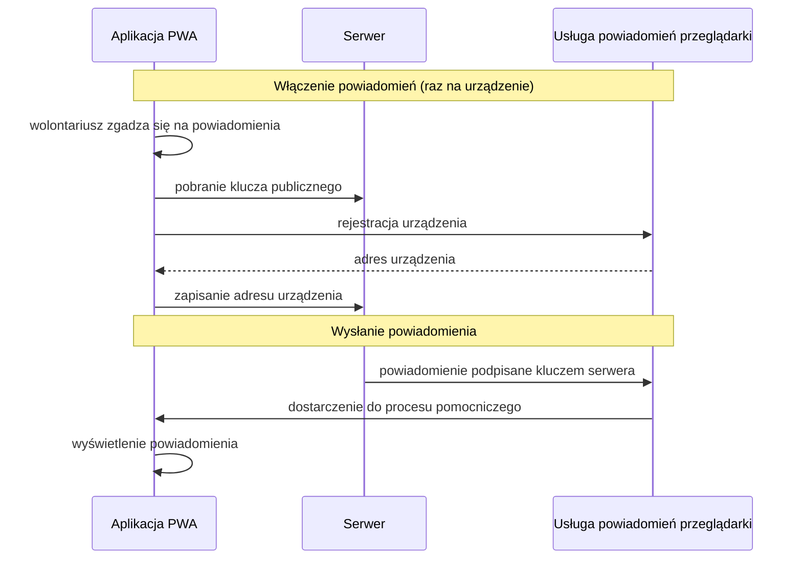

# Aplikacja PWA i powiadomienia

Interfejs jest aplikacją PWA: stroną internetową, którą można zainstalować na telefonie lub komputerze i uruchamiać jak osobny program, bez paska przeglądarki. Zainstalowana aplikacja nazywa się „Volunteer LIVE”.

PWA opiera się na procesie pomocniczym przeglądarki (service worker, `frontend/src/sw.ts`), który działa także wtedy, gdy aplikacja jest zamknięta. Proces ten odpowiada za trzy rzeczy:

- przechowuje pliki interfejsu na urządzeniu, więc aplikacja otwiera się bez pobierania ich od nowa,
- przechowuje ostatnie odpowiedzi serwera dla trzech grup danych: zmian, ekranu Conops i profilu; gdy serwer nie odpowie w 15 sekund, aplikacja pokazuje zapisane dane,
- odbiera powiadomienia i wyświetla je na urządzeniu.

Powiadomienia na urządzenie (Web Push) wymagają PWA, bo dostarcza je właśnie proces pomocniczy. Drogę powiadomienia przedstawia rysunek 1.

*Rys. 1. Włączenie i dostarczenie powiadomienia*

Serwer nie wysyła powiadomień bezpośrednio na urządzenie. Przekazuje je usłudze prowadzonej przez producenta przeglądarki (np. Google, Apple, Mozilla), a ta dostarcza je na urządzenie. Serwer podpisuje każde powiadomienie własnym kluczem (VAPID), żeby usługa wiedziała, kto je wysyła.

Adres urządzenia serwer zapisuje osobno dla każdego użytkownika i urządzenia (`PushSubscription` w `backend/notifications/`). Wolontariusz, który korzysta z telefonu i komputera, włącza powiadomienia na każdym z nich. Po kliknięciu powiadomienie otwiera odpowiedni ekran aplikacji.

Tą drogą system wysyła między innymi przypomnienia o zmianach. Powiadomienie testowe można wysłać z ekranu „Live”.
